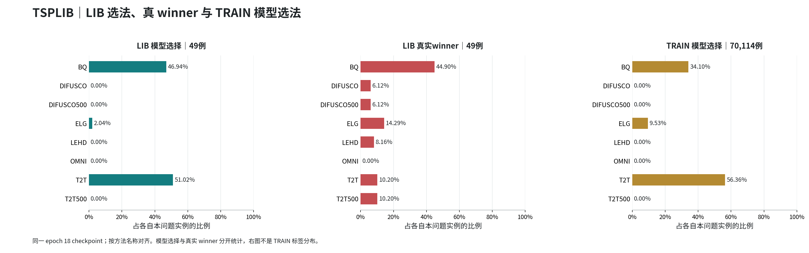
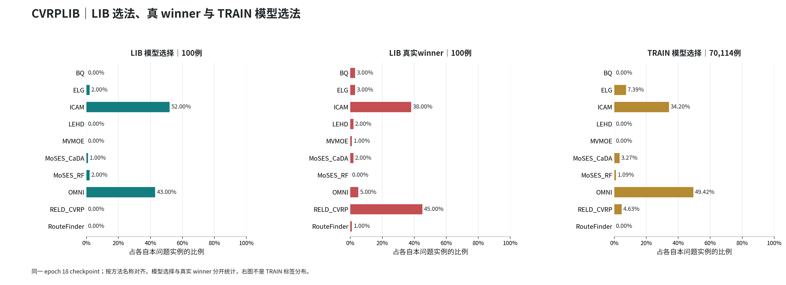

# R76 LIB 选择/真实 winner 与 TRAIN 模型选择分布

复用 TEST 分布报告的中文横向条形图、独立分母、表格、逐问题 PNG/PDF/CSV、HTML 和整包样式；不覆盖 TEST 报告。

同一锁定 epoch 18，checkpoint SHA256 `5ba5777e437235e22682c4d54cfd8cdefca6fb53c27204a8e1e3f753ea9043c9`。无新推理或训练，候选按名称对齐并验证 global solver ID。

每图三栏：LIB 模型选法、LIB native 标签真实 winner、TRAIN 模型选法。TRAIN 标签频数另有明确字段，不替代模型选择；仅比较 TSP/CVRP 各自对应问题，不混合18题。

[PDF](selection_distributions.pdf) · [长表CSV](selection_distribution.csv) · [名称对齐宽表](comparison.csv) · [完整图表包](selection_distribution_bundle.zip)

## TSPLIB

LIB Top1 28.57%；LIB 与 TRAIN 选法总变差距离 12.84%。

| 方法 | LIB 选择数/比例 | LIB winner数/比例 | TRAIN 模型选择数/比例 | LIB−TRAIN 选择 pp |
| --- | ---: | ---: | ---: | ---: |
| BQ | 23 / 46.94% | 22 / 44.90% | 23,911 / 34.10% | +12.84 |
| DIFUSCO | 0 / 0.00% | 3 / 6.12% | 0 / 0.00% | +0.00 |
| DIFUSCO500 | 0 / 0.00% | 3 / 6.12% | 0 / 0.00% | +0.00 |
| ELG | 1 / 2.04% | 7 / 14.29% | 6,685 / 9.53% | -7.49 |
| LEHD | 0 / 0.00% | 4 / 8.16% | 0 / 0.00% | +0.00 |
| OMNI | 0 / 0.00% | 0 / 0.00% | 0 / 0.00% | +0.00 |
| T2T | 25 / 51.02% | 5 / 10.20% | 39,518 / 56.36% | -5.34 |
| T2T500 | 0 / 0.00% | 5 / 10.20% | 0 / 0.00% | +0.00 |

[该问题CSV](tables/TSPLIB.csv) · [本图PDF](figures/TSPLIB.pdf)

## CVRPLIB

LIB Top1 33.00%；LIB 与 TRAIN 选法总变差距离 18.71%。

| 方法 | LIB 选择数/比例 | LIB winner数/比例 | TRAIN 模型选择数/比例 | LIB−TRAIN 选择 pp |
| --- | ---: | ---: | ---: | ---: |
| BQ | 0 / 0.00% | 3 / 3.00% | 0 / 0.00% | +0.00 |
| ELG | 2 / 2.00% | 3 / 3.00% | 5,182 / 7.39% | -5.39 |
| ICAM | 52 / 52.00% | 38 / 38.00% | 23,976 / 34.20% | +17.80 |
| LEHD | 0 / 0.00% | 2 / 2.00% | 3 / 0.00% | -0.00 |
| MVMOE | 0 / 0.00% | 1 / 1.00% | 0 / 0.00% | +0.00 |
| MoSES_CaDA | 1 / 1.00% | 2 / 2.00% | 2,295 / 3.27% | -2.27 |
| MoSES_RF | 2 / 2.00% | 0 / 0.00% | 764 / 1.09% | +0.91 |
| OMNI | 43 / 43.00% | 5 / 5.00% | 34,649 / 49.42% | -6.42 |
| RELD_CVRP | 0 / 0.00% | 45 / 45.00% | 3,245 / 4.63% | -4.63 |
| RouteFinder | 0 / 0.00% | 1 / 1.00% | 0 / 0.00% | +0.00 |

[该问题CSV](tables/CVRPLIB.csv) · [本图PDF](figures/CVRPLIB.pdf)
