# 模型test结果：各问题的方法选择情况

结果目录：`/public/home/shiys/0selection2/code/V4/runs/R76_R45A_single_reld_mt`。使用已锁定权重的完整test预测，不重新推理、不更换checkpoint。

18种问题分别统计。左图表示模型选择比例，右图表示真实winner比例；每个比例的分母只使用该问题的测试实例数。

表格并列模型选择数量／比例与真实winner数量／比例。差值为选择比例减winner比例，单位为百分点，不代表该方法的选择一定合理或不合理。

`reld_mt`沿用保存预测中的方法名称，对应当前数据中保留的MOEL部署。

[18页PDF](selection_distributions.pdf) · [全部选择分布CSV](selection_distribution.csv) · [完整图表包](selection_distribution_bundle.zip)

**问题目录：** [TSP](#tsp) · [CVRP](#cvrp) · [ATSP](#atsp) · [OVRP](#ovrp) · [VRPB](#vrpb) · [VRPL](#vrpl) · [VRPTW](#vrptw) · [OVRPTW](#ovrptw) · [OVRPB](#ovrpb) · [OVRPL](#ovrpl) · [VRPBL](#vrpbl) · [VRPBTW](#vrpbtw) · [VRPLTW](#vrpltw) · [OVRPBL](#ovrpbl) · [OVRPBTW](#ovrpbtw) · [OVRPLTW](#ovrpltw) · [VRPBLTW](#vrpbltw) · [OVRPBLTW](#ovrpbltw)

## TSP

测试集3,895例，模型Top1为43.21%。

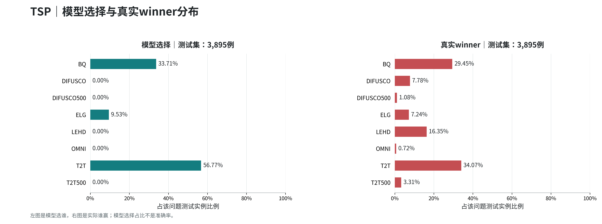

| 方法 | 模型选择数量 | 选择比例 | 真实winner数量 | winner比例 | 比例差 pp |
| --- | ---: | ---: | ---: | ---: | ---: |
| BQ | 1,313 | 33.71% | 1,147 | 29.45% | +4.26 |
| DIFUSCO | 0 | 0.00% | 303 | 7.78% | -7.78 |
| DIFUSCO500 | 0 | 0.00% | 42 | 1.08% | -1.08 |
| ELG | 371 | 9.53% | 282 | 7.24% | +2.28 |
| LEHD | 0 | 0.00% | 637 | 16.35% | -16.35 |
| OMNI | 0 | 0.00% | 28 | 0.72% | -0.72 |
| T2T | 2,211 | 56.77% | 1,327 | 34.07% | +22.70 |
| T2T500 | 0 | 0.00% | 129 | 3.31% | -3.31 |

[该问题CSV](tables/TSP.csv) · [本图PDF](figures/TSP.pdf)

## CVRP

测试集3,895例，模型Top1为33.89%。

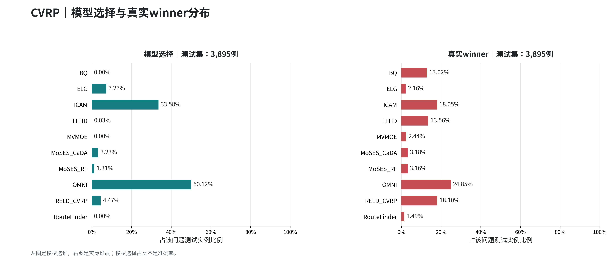

| 方法 | 模型选择数量 | 选择比例 | 真实winner数量 | winner比例 | 比例差 pp |
| --- | ---: | ---: | ---: | ---: | ---: |
| BQ | 0 | 0.00% | 507 | 13.02% | -13.02 |
| ELG | 283 | 7.27% | 84 | 2.16% | +5.11 |
| ICAM | 1,308 | 33.58% | 703 | 18.05% | +15.53 |
| LEHD | 1 | 0.03% | 528 | 13.56% | -13.53 |
| MVMOE | 0 | 0.00% | 95 | 2.44% | -2.44 |
| MoSES_CaDA | 126 | 3.23% | 124 | 3.18% | +0.05 |
| MoSES_RF | 51 | 1.31% | 123 | 3.16% | -1.85 |
| OMNI | 1,952 | 50.12% | 968 | 24.85% | +25.26 |
| RELD_CVRP | 174 | 4.47% | 705 | 18.10% | -13.63 |
| RouteFinder | 0 | 0.00% | 58 | 1.49% | -1.49 |

[该问题CSV](tables/CVRP.csv) · [本图PDF](figures/CVRP.pdf)

## ATSP

测试集3,895例，模型Top1为74.48%。

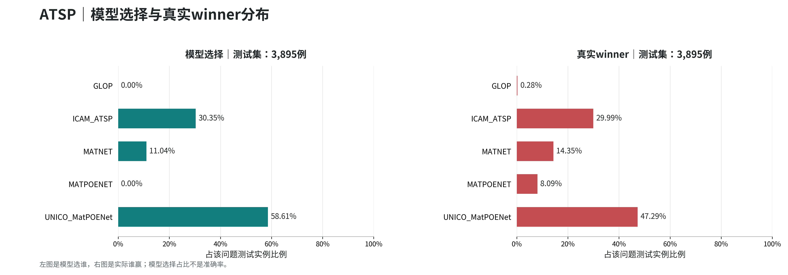

| 方法 | 模型选择数量 | 选择比例 | 真实winner数量 | winner比例 | 比例差 pp |
| --- | ---: | ---: | ---: | ---: | ---: |
| GLOP | 0 | 0.00% | 11 | 0.28% | -0.28 |
| ICAM_ATSP | 1,182 | 30.35% | 1,168 | 29.99% | +0.36 |
| MATNET | 430 | 11.04% | 559 | 14.35% | -3.31 |
| MATPOENET | 0 | 0.00% | 315 | 8.09% | -8.09 |
| UNICO_MatPOENet | 2,283 | 58.61% | 1,842 | 47.29% | +11.32 |

[该问题CSV](tables/ATSP.csv) · [本图PDF](figures/ATSP.pdf)

## OVRP

测试集3,895例，模型Top1为36.77%。

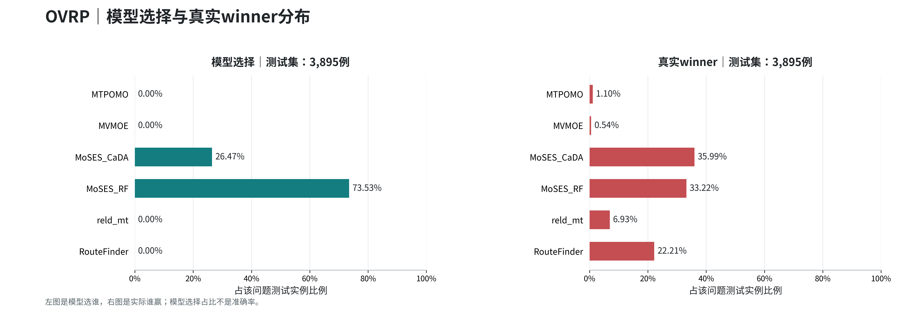

| 方法 | 模型选择数量 | 选择比例 | 真实winner数量 | winner比例 | 比例差 pp |
| --- | ---: | ---: | ---: | ---: | ---: |
| MTPOMO | 0 | 0.00% | 43 | 1.10% | -1.10 |
| MVMOE | 0 | 0.00% | 21 | 0.54% | -0.54 |
| MoSES_CaDA | 1,031 | 26.47% | 1,402 | 35.99% | -9.53 |
| MoSES_RF | 2,864 | 73.53% | 1,294 | 33.22% | +40.31 |
| reld_mt | 0 | 0.00% | 270 | 6.93% | -6.93 |
| RouteFinder | 0 | 0.00% | 865 | 22.21% | -22.21 |

[该问题CSV](tables/OVRP.csv) · [本图PDF](figures/OVRP.pdf)

## VRPB

测试集3,895例，模型Top1为80.10%。

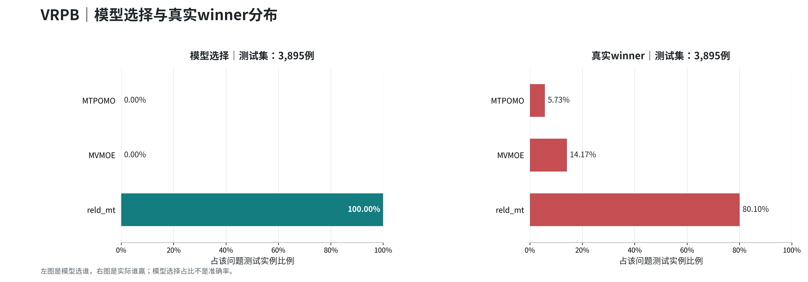

| 方法 | 模型选择数量 | 选择比例 | 真实winner数量 | winner比例 | 比例差 pp |
| --- | ---: | ---: | ---: | ---: | ---: |
| MTPOMO | 0 | 0.00% | 223 | 5.73% | -5.73 |
| MVMOE | 0 | 0.00% | 552 | 14.17% | -14.17 |
| reld_mt | 3,895 | 100.00% | 3,120 | 80.10% | +19.90 |

[该问题CSV](tables/VRPB.csv) · [本图PDF](figures/VRPB.pdf)

## VRPL

测试集3,895例，模型Top1为32.53%。

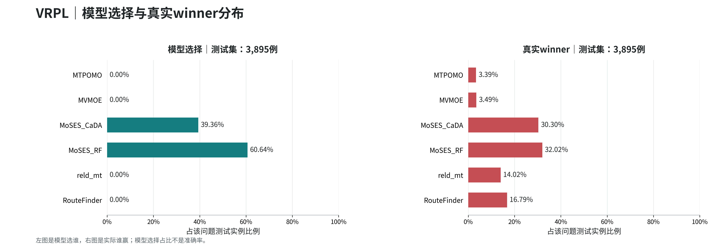

| 方法 | 模型选择数量 | 选择比例 | 真实winner数量 | winner比例 | 比例差 pp |
| --- | ---: | ---: | ---: | ---: | ---: |
| MTPOMO | 0 | 0.00% | 132 | 3.39% | -3.39 |
| MVMOE | 0 | 0.00% | 136 | 3.49% | -3.49 |
| MoSES_CaDA | 1,533 | 39.36% | 1,180 | 30.30% | +9.06 |
| MoSES_RF | 2,362 | 60.64% | 1,247 | 32.02% | +28.63 |
| reld_mt | 0 | 0.00% | 546 | 14.02% | -14.02 |
| RouteFinder | 0 | 0.00% | 654 | 16.79% | -16.79 |

[该问题CSV](tables/VRPL.csv) · [本图PDF](figures/VRPL.pdf)

## VRPTW

测试集3,895例，模型Top1为80.85%。

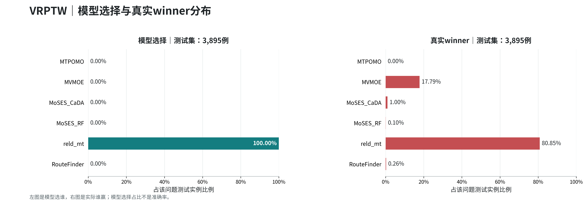

| 方法 | 模型选择数量 | 选择比例 | 真实winner数量 | winner比例 | 比例差 pp |
| --- | ---: | ---: | ---: | ---: | ---: |
| MTPOMO | 0 | 0.00% | 0 | 0.00% | +0.00 |
| MVMOE | 0 | 0.00% | 693 | 17.79% | -17.79 |
| MoSES_CaDA | 0 | 0.00% | 39 | 1.00% | -1.00 |
| MoSES_RF | 0 | 0.00% | 4 | 0.10% | -0.10 |
| reld_mt | 3,895 | 100.00% | 3,149 | 80.85% | +19.15 |
| RouteFinder | 0 | 0.00% | 10 | 0.26% | -0.26 |

[该问题CSV](tables/VRPTW.csv) · [本图PDF](figures/VRPTW.pdf)

## OVRPTW

测试集3,895例，模型Top1为84.03%。

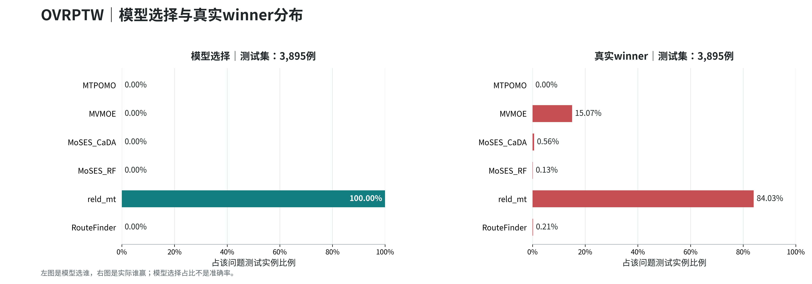

| 方法 | 模型选择数量 | 选择比例 | 真实winner数量 | winner比例 | 比例差 pp |
| --- | ---: | ---: | ---: | ---: | ---: |
| MTPOMO | 0 | 0.00% | 0 | 0.00% | +0.00 |
| MVMOE | 0 | 0.00% | 587 | 15.07% | -15.07 |
| MoSES_CaDA | 0 | 0.00% | 22 | 0.56% | -0.56 |
| MoSES_RF | 0 | 0.00% | 5 | 0.13% | -0.13 |
| reld_mt | 3,895 | 100.00% | 3,273 | 84.03% | +15.97 |
| RouteFinder | 0 | 0.00% | 8 | 0.21% | -0.21 |

[该问题CSV](tables/OVRPTW.csv) · [本图PDF](figures/OVRPTW.pdf)

## OVRPB

测试集3,895例，模型Top1为88.09%。

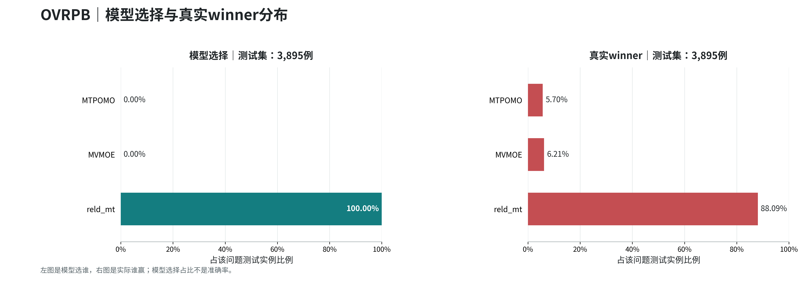

| 方法 | 模型选择数量 | 选择比例 | 真实winner数量 | winner比例 | 比例差 pp |
| --- | ---: | ---: | ---: | ---: | ---: |
| MTPOMO | 0 | 0.00% | 222 | 5.70% | -5.70 |
| MVMOE | 0 | 0.00% | 242 | 6.21% | -6.21 |
| reld_mt | 3,895 | 100.00% | 3,431 | 88.09% | +11.91 |

[该问题CSV](tables/OVRPB.csv) · [本图PDF](figures/OVRPB.pdf)

## OVRPL

测试集3,895例，模型Top1为37.33%。

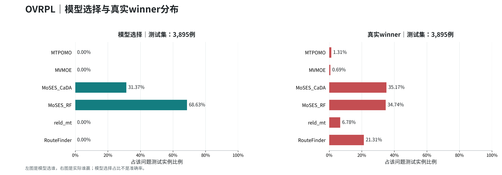

| 方法 | 模型选择数量 | 选择比例 | 真实winner数量 | winner比例 | 比例差 pp |
| --- | ---: | ---: | ---: | ---: | ---: |
| MTPOMO | 0 | 0.00% | 51 | 1.31% | -1.31 |
| MVMOE | 0 | 0.00% | 27 | 0.69% | -0.69 |
| MoSES_CaDA | 1,222 | 31.37% | 1,370 | 35.17% | -3.80 |
| MoSES_RF | 2,673 | 68.63% | 1,353 | 34.74% | +33.89 |
| reld_mt | 0 | 0.00% | 264 | 6.78% | -6.78 |
| RouteFinder | 0 | 0.00% | 830 | 21.31% | -21.31 |

[该问题CSV](tables/OVRPL.csv) · [本图PDF](figures/OVRPL.pdf)

## VRPBL

测试集3,895例，模型Top1为79.67%。

| 方法 | 模型选择数量 | 选择比例 | 真实winner数量 | winner比例 | 比例差 pp |
| --- | ---: | ---: | ---: | ---: | ---: |
| MTPOMO | 0 | 0.00% | 193 | 4.96% | -4.96 |
| MVMOE | 0 | 0.00% | 599 | 15.38% | -15.38 |
| reld_mt | 3,895 | 100.00% | 3,103 | 79.67% | +20.33 |

[该问题CSV](tables/VRPBL.csv) · [本图PDF](figures/VRPBL.pdf)

## VRPBTW

测试集3,895例，模型Top1为78.79%。

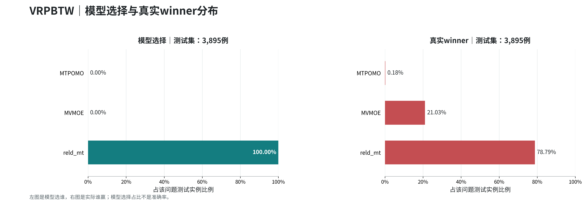

| 方法 | 模型选择数量 | 选择比例 | 真实winner数量 | winner比例 | 比例差 pp |
| --- | ---: | ---: | ---: | ---: | ---: |
| MTPOMO | 0 | 0.00% | 7 | 0.18% | -0.18 |
| MVMOE | 0 | 0.00% | 819 | 21.03% | -21.03 |
| reld_mt | 3,895 | 100.00% | 3,069 | 78.79% | +21.21 |

[该问题CSV](tables/VRPBTW.csv) · [本图PDF](figures/VRPBTW.pdf)

## VRPLTW

测试集3,895例，模型Top1为79.61%。

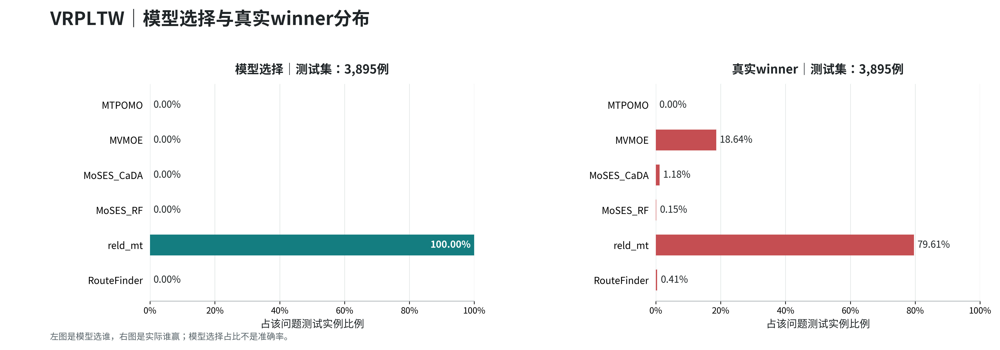

| 方法 | 模型选择数量 | 选择比例 | 真实winner数量 | winner比例 | 比例差 pp |
| --- | ---: | ---: | ---: | ---: | ---: |
| MTPOMO | 0 | 0.00% | 0 | 0.00% | +0.00 |
| MVMOE | 0 | 0.00% | 726 | 18.64% | -18.64 |
| MoSES_CaDA | 0 | 0.00% | 46 | 1.18% | -1.18 |
| MoSES_RF | 0 | 0.00% | 6 | 0.15% | -0.15 |
| reld_mt | 3,895 | 100.00% | 3,101 | 79.61% | +20.39 |
| RouteFinder | 0 | 0.00% | 16 | 0.41% | -0.41 |

[该问题CSV](tables/VRPLTW.csv) · [本图PDF](figures/VRPLTW.pdf)

## OVRPBL

测试集3,895例，模型Top1为89.55%。

| 方法 | 模型选择数量 | 选择比例 | 真实winner数量 | winner比例 | 比例差 pp |
| --- | ---: | ---: | ---: | ---: | ---: |
| MTPOMO | 0 | 0.00% | 183 | 4.70% | -4.70 |
| MVMOE | 0 | 0.00% | 224 | 5.75% | -5.75 |
| reld_mt | 3,895 | 100.00% | 3,488 | 89.55% | +10.45 |

[该问题CSV](tables/OVRPBL.csv) · [本图PDF](figures/OVRPBL.pdf)

## OVRPBTW

测试集3,895例，模型Top1为84.83%。

| 方法 | 模型选择数量 | 选择比例 | 真实winner数量 | winner比例 | 比例差 pp |
| --- | ---: | ---: | ---: | ---: | ---: |
| MTPOMO | 0 | 0.00% | 0 | 0.00% | +0.00 |
| MVMOE | 0 | 0.00% | 591 | 15.17% | -15.17 |
| reld_mt | 3,895 | 100.00% | 3,304 | 84.83% | +15.17 |

[该问题CSV](tables/OVRPBTW.csv) · [本图PDF](figures/OVRPBTW.pdf)

## OVRPLTW

测试集3,895例，模型Top1为83.11%。

| 方法 | 模型选择数量 | 选择比例 | 真实winner数量 | winner比例 | 比例差 pp |
| --- | ---: | ---: | ---: | ---: | ---: |
| MTPOMO | 0 | 0.00% | 0 | 0.00% | +0.00 |
| MVMOE | 0 | 0.00% | 622 | 15.97% | -15.97 |
| MoSES_CaDA | 0 | 0.00% | 23 | 0.59% | -0.59 |
| MoSES_RF | 0 | 0.00% | 3 | 0.08% | -0.08 |
| reld_mt | 3,895 | 100.00% | 3,237 | 83.11% | +16.89 |
| RouteFinder | 0 | 0.00% | 10 | 0.26% | -0.26 |

[该问题CSV](tables/OVRPLTW.csv) · [本图PDF](figures/OVRPLTW.pdf)

## VRPBLTW

测试集3,895例，模型Top1为79.61%。

| 方法 | 模型选择数量 | 选择比例 | 真实winner数量 | winner比例 | 比例差 pp |
| --- | ---: | ---: | ---: | ---: | ---: |
| MTPOMO | 0 | 0.00% | 3 | 0.08% | -0.08 |
| MVMOE | 0 | 0.00% | 791 | 20.31% | -20.31 |
| reld_mt | 3,895 | 100.00% | 3,101 | 79.61% | +20.39 |

[该问题CSV](tables/VRPBLTW.csv) · [本图PDF](figures/VRPBLTW.pdf)

## OVRPBLTW

测试集3,895例，模型Top1为83.47%。

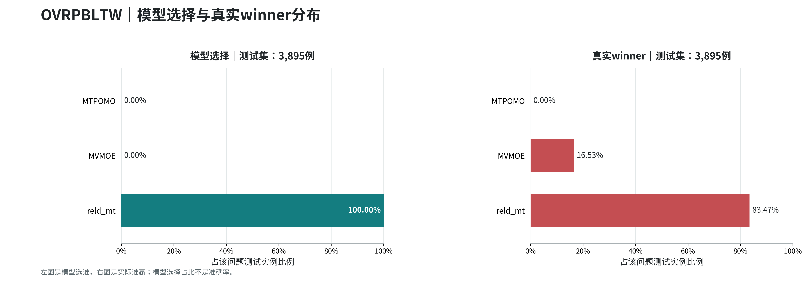

| 方法 | 模型选择数量 | 选择比例 | 真实winner数量 | winner比例 | 比例差 pp |
| --- | ---: | ---: | ---: | ---: | ---: |
| MTPOMO | 0 | 0.00% | 0 | 0.00% | +0.00 |
| MVMOE | 0 | 0.00% | 644 | 16.53% | -16.53 |
| reld_mt | 3,895 | 100.00% | 3,251 | 83.47% | +16.53 |

[该问题CSV](tables/OVRPBLTW.csv) · [本图PDF](figures/OVRPBLTW.pdf)
