# 当前数据：18种问题各方法获胜实例占比

数据目录：`/public/home/shiys/selection_data_new_only_B_filtered_single_reld_mt_seed2_20261014`。

每种问题：训练集70,114例、测试集3,895例。只统计现有候选池，不模拟删除，不包含validation。

每个问题独立展示。左图为训练集，右图为测试集；每个方法一根柱，横轴统一为0–100%。表格同时保留获胜数量和比例。

获胜比例使用该目录已发布的winner计数，分母为该问题对应划分的全部实例数，不是模型预测准确率。

`reld_mt`对应原RELD_MOEL；RELD_MTL已移除。候选及顺序取自此目录的元数据，不沿用旧候选池或文件名字母排序。

[18页图表PDF](winner_distributions.pdf) · [完整图表包](distribution_bundle.zip) · [训练与测试CSV](winner_distribution.csv)

**问题目录：** [TSP](#tsp) · [CVRP](#cvrp) · [ATSP](#atsp) · [OVRP](#ovrp) · [VRPB](#vrpb) · [VRPL](#vrpl) · [VRPTW](#vrptw) · [OVRPTW](#ovrptw) · [OVRPB](#ovrpb) · [OVRPL](#ovrpl) · [VRPBL](#vrpbl) · [VRPBTW](#vrpbtw) · [VRPLTW](#vrpltw) · [OVRPBL](#ovrpbl) · [OVRPBTW](#ovrpbtw) · [OVRPLTW](#ovrpltw) · [VRPBLTW](#vrpbltw) · [OVRPBLTW](#ovrpbltw)

## TSP

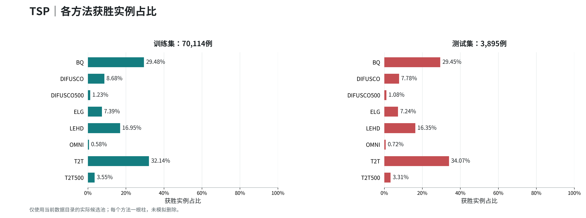

| 方法 | 训练获胜数量 | 训练比例 | 测试获胜数量 | 测试比例 |
| --- | ---: | ---: | ---: | ---: |
| BQ | 20,669 | 29.48% | 1,147 | 29.45% |
| DIFUSCO | 6,084 | 8.68% | 303 | 7.78% |
| DIFUSCO500 | 865 | 1.23% | 42 | 1.08% |
| ELG | 5,184 | 7.39% | 282 | 7.24% |
| LEHD | 11,881 | 16.95% | 637 | 16.35% |
| OMNI | 404 | 0.58% | 28 | 0.72% |
| T2T | 22,538 | 32.14% | 1,327 | 34.07% |
| T2T500 | 2,489 | 3.55% | 129 | 3.31% |

[该问题CSV](tables/TSP.csv) · [本图PDF](figures/TSP.pdf)

## CVRP

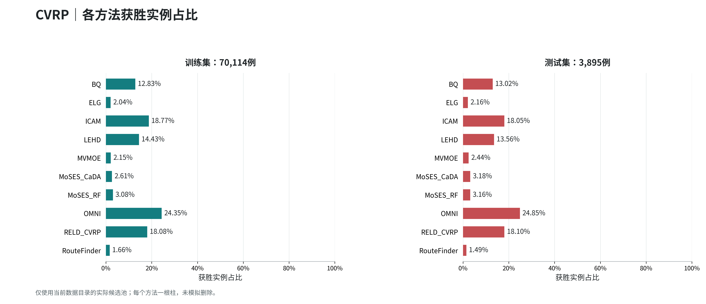

| 方法 | 训练获胜数量 | 训练比例 | 测试获胜数量 | 测试比例 |
| --- | ---: | ---: | ---: | ---: |
| BQ | 8,999 | 12.83% | 507 | 13.02% |
| ELG | 1,428 | 2.04% | 84 | 2.16% |
| ICAM | 13,158 | 18.77% | 703 | 18.05% |
| LEHD | 10,116 | 14.43% | 528 | 13.56% |
| MVMOE | 1,506 | 2.15% | 95 | 2.44% |
| MoSES_CaDA | 1,832 | 2.61% | 124 | 3.18% |
| MoSES_RF | 2,163 | 3.08% | 123 | 3.16% |
| OMNI | 17,073 | 24.35% | 968 | 24.85% |
| RELD_CVRP | 12,676 | 18.08% | 705 | 18.10% |
| RouteFinder | 1,163 | 1.66% | 58 | 1.49% |

[该问题CSV](tables/CVRP.csv) · [本图PDF](figures/CVRP.pdf)

## ATSP

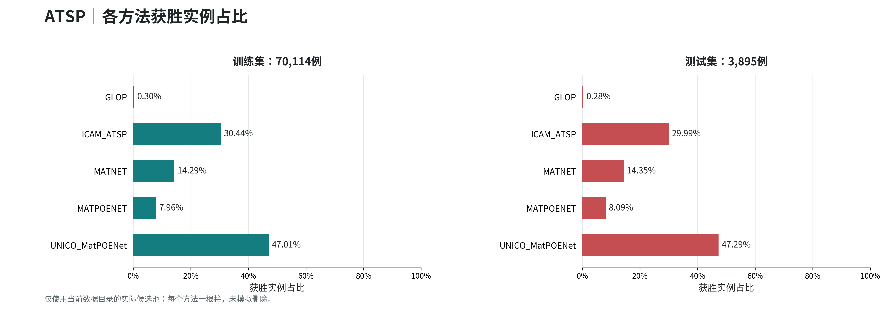

| 方法 | 训练获胜数量 | 训练比例 | 测试获胜数量 | 测试比例 |
| --- | ---: | ---: | ---: | ---: |
| GLOP | 210 | 0.30% | 11 | 0.28% |
| ICAM_ATSP | 21,342 | 30.44% | 1,168 | 29.99% |
| MATNET | 10,022 | 14.29% | 559 | 14.35% |
| MATPOENET | 5,579 | 7.96% | 315 | 8.09% |
| UNICO_MatPOENet | 32,961 | 47.01% | 1,842 | 47.29% |

[该问题CSV](tables/ATSP.csv) · [本图PDF](figures/ATSP.pdf)

## OVRP

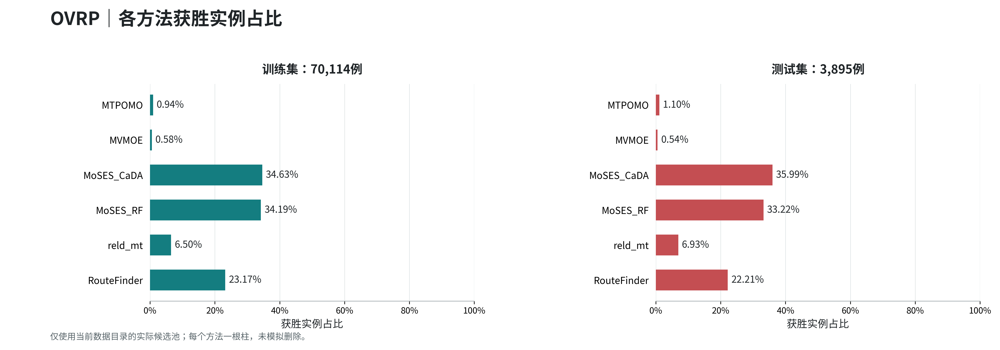

| 方法 | 训练获胜数量 | 训练比例 | 测试获胜数量 | 测试比例 |
| --- | ---: | ---: | ---: | ---: |
| MTPOMO | 660 | 0.94% | 43 | 1.10% |
| MVMOE | 404 | 0.58% | 21 | 0.54% |
| MoSES_CaDA | 24,277 | 34.63% | 1,402 | 35.99% |
| MoSES_RF | 23,970 | 34.19% | 1,294 | 33.22% |
| reld_mt | 4,556 | 6.50% | 270 | 6.93% |
| RouteFinder | 16,247 | 23.17% | 865 | 22.21% |

[该问题CSV](tables/OVRP.csv) · [本图PDF](figures/OVRP.pdf)

## VRPB

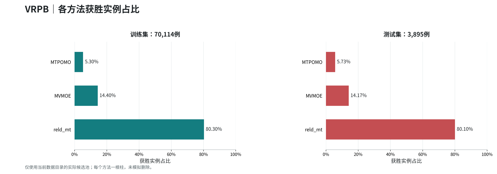

| 方法 | 训练获胜数量 | 训练比例 | 测试获胜数量 | 测试比例 |
| --- | ---: | ---: | ---: | ---: |
| MTPOMO | 3,716 | 5.30% | 223 | 5.73% |
| MVMOE | 10,094 | 14.40% | 552 | 14.17% |
| reld_mt | 56,304 | 80.30% | 3,120 | 80.10% |

[该问题CSV](tables/VRPB.csv) · [本图PDF](figures/VRPB.pdf)

## VRPL

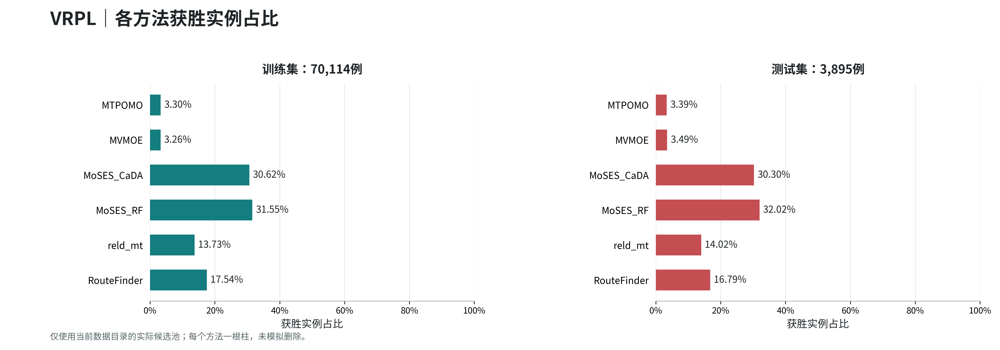

| 方法 | 训练获胜数量 | 训练比例 | 测试获胜数量 | 测试比例 |
| --- | ---: | ---: | ---: | ---: |
| MTPOMO | 2,314 | 3.30% | 132 | 3.39% |
| MVMOE | 2,283 | 3.26% | 136 | 3.49% |
| MoSES_CaDA | 21,472 | 30.62% | 1,180 | 30.30% |
| MoSES_RF | 22,124 | 31.55% | 1,247 | 32.02% |
| reld_mt | 9,625 | 13.73% | 546 | 14.02% |
| RouteFinder | 12,296 | 17.54% | 654 | 16.79% |

[该问题CSV](tables/VRPL.csv) · [本图PDF](figures/VRPL.pdf)

## VRPTW

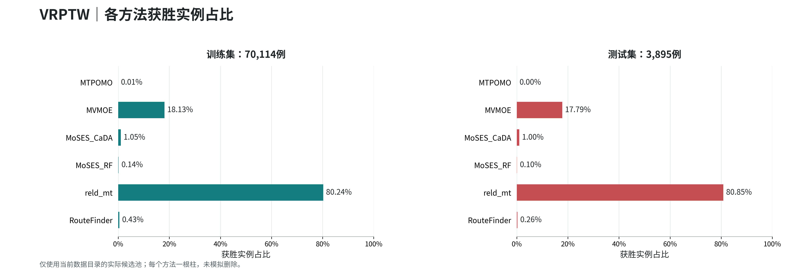

| 方法 | 训练获胜数量 | 训练比例 | 测试获胜数量 | 测试比例 |
| --- | ---: | ---: | ---: | ---: |
| MTPOMO | 4 | 0.01% | 0 | 0.00% |
| MVMOE | 12,713 | 18.13% | 693 | 17.79% |
| MoSES_CaDA | 738 | 1.05% | 39 | 1.00% |
| MoSES_RF | 98 | 0.14% | 4 | 0.10% |
| reld_mt | 56,257 | 80.24% | 3,149 | 80.85% |
| RouteFinder | 304 | 0.43% | 10 | 0.26% |

[该问题CSV](tables/VRPTW.csv) · [本图PDF](figures/VRPTW.pdf)

## OVRPTW

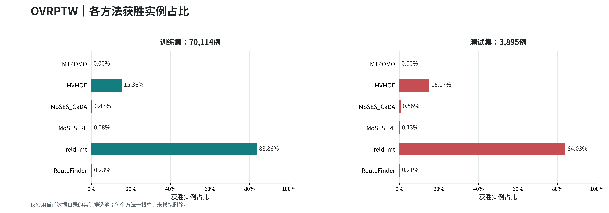

| 方法 | 训练获胜数量 | 训练比例 | 测试获胜数量 | 测试比例 |
| --- | ---: | ---: | ---: | ---: |
| MTPOMO | 0 | 0.00% | 0 | 0.00% |
| MVMOE | 10,770 | 15.36% | 587 | 15.07% |
| MoSES_CaDA | 327 | 0.47% | 22 | 0.56% |
| MoSES_RF | 58 | 0.08% | 5 | 0.13% |
| reld_mt | 58,801 | 83.86% | 3,273 | 84.03% |
| RouteFinder | 158 | 0.23% | 8 | 0.21% |

[该问题CSV](tables/OVRPTW.csv) · [本图PDF](figures/OVRPTW.pdf)

## OVRPB

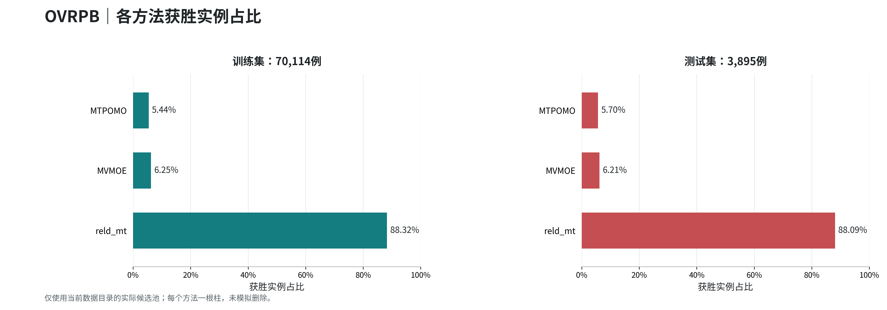

| 方法 | 训练获胜数量 | 训练比例 | 测试获胜数量 | 测试比例 |
| --- | ---: | ---: | ---: | ---: |
| MTPOMO | 3,813 | 5.44% | 222 | 5.70% |
| MVMOE | 4,379 | 6.25% | 242 | 6.21% |
| reld_mt | 61,922 | 88.32% | 3,431 | 88.09% |

[该问题CSV](tables/OVRPB.csv) · [本图PDF](figures/OVRPB.pdf)

## OVRPL

| 方法 | 训练获胜数量 | 训练比例 | 测试获胜数量 | 测试比例 |
| --- | ---: | ---: | ---: | ---: |
| MTPOMO | 616 | 0.88% | 51 | 1.31% |
| MVMOE | 430 | 0.61% | 27 | 0.69% |
| MoSES_CaDA | 24,949 | 35.58% | 1,370 | 35.17% |
| MoSES_RF | 24,152 | 34.45% | 1,353 | 34.74% |
| reld_mt | 4,477 | 6.39% | 264 | 6.78% |
| RouteFinder | 15,490 | 22.09% | 830 | 21.31% |

[该问题CSV](tables/OVRPL.csv) · [本图PDF](figures/OVRPL.pdf)

## VRPBL

| 方法 | 训练获胜数量 | 训练比例 | 测试获胜数量 | 测试比例 |
| --- | ---: | ---: | ---: | ---: |
| MTPOMO | 3,671 | 5.24% | 193 | 4.96% |
| MVMOE | 10,772 | 15.36% | 599 | 15.38% |
| reld_mt | 55,671 | 79.40% | 3,103 | 79.67% |

[该问题CSV](tables/VRPBL.csv) · [本图PDF](figures/VRPBL.pdf)

## VRPBTW

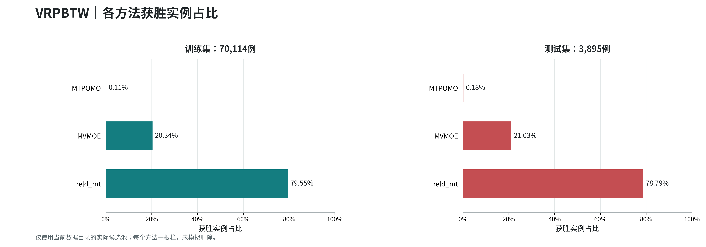

| 方法 | 训练获胜数量 | 训练比例 | 测试获胜数量 | 测试比例 |
| --- | ---: | ---: | ---: | ---: |
| MTPOMO | 75 | 0.11% | 7 | 0.18% |
| MVMOE | 14,262 | 20.34% | 819 | 21.03% |
| reld_mt | 55,777 | 79.55% | 3,069 | 78.79% |

[该问题CSV](tables/VRPBTW.csv) · [本图PDF](figures/VRPBTW.pdf)

## VRPLTW

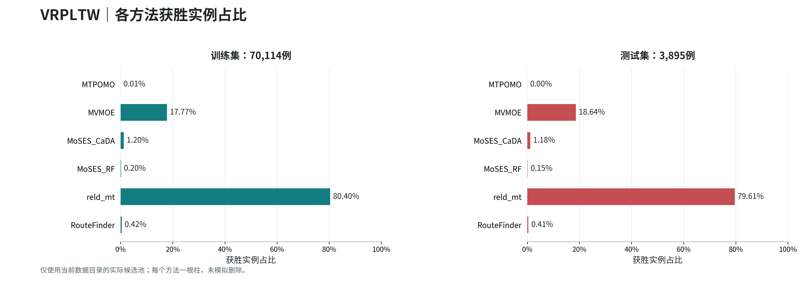

| 方法 | 训练获胜数量 | 训练比例 | 测试获胜数量 | 测试比例 |
| --- | ---: | ---: | ---: | ---: |
| MTPOMO | 4 | 0.01% | 0 | 0.00% |
| MVMOE | 12,461 | 17.77% | 726 | 18.64% |
| MoSES_CaDA | 843 | 1.20% | 46 | 1.18% |
| MoSES_RF | 140 | 0.20% | 6 | 0.15% |
| reld_mt | 56,372 | 80.40% | 3,101 | 79.61% |
| RouteFinder | 294 | 0.42% | 16 | 0.41% |

[该问题CSV](tables/VRPLTW.csv) · [本图PDF](figures/VRPLTW.pdf)

## OVRPBL

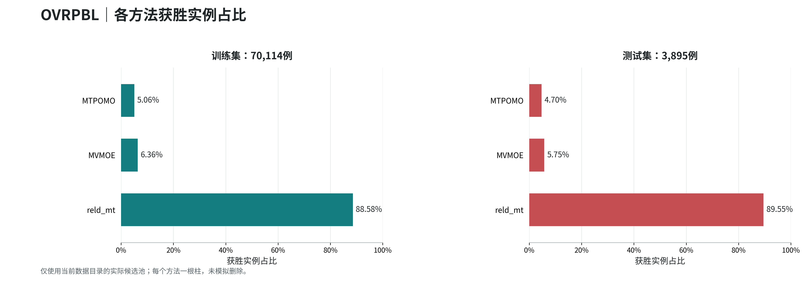

| 方法 | 训练获胜数量 | 训练比例 | 测试获胜数量 | 测试比例 |
| --- | ---: | ---: | ---: | ---: |
| MTPOMO | 3,546 | 5.06% | 183 | 4.70% |
| MVMOE | 4,460 | 6.36% | 224 | 5.75% |
| reld_mt | 62,108 | 88.58% | 3,488 | 89.55% |

[该问题CSV](tables/OVRPBL.csv) · [本图PDF](figures/OVRPBL.pdf)

## OVRPBTW

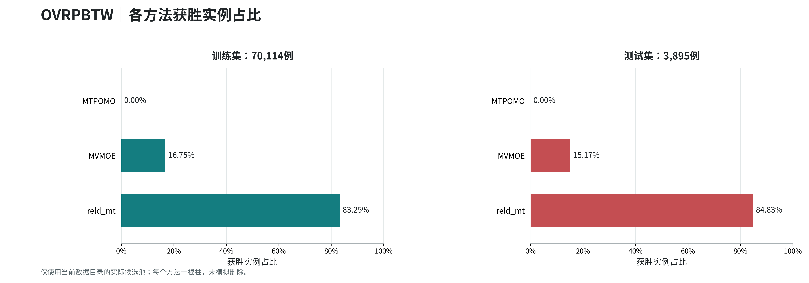

| 方法 | 训练获胜数量 | 训练比例 | 测试获胜数量 | 测试比例 |
| --- | ---: | ---: | ---: | ---: |
| MTPOMO | 0 | 0.00% | 0 | 0.00% |
| MVMOE | 11,743 | 16.75% | 591 | 15.17% |
| reld_mt | 58,371 | 83.25% | 3,304 | 84.83% |

[该问题CSV](tables/OVRPBTW.csv) · [本图PDF](figures/OVRPBTW.pdf)

## OVRPLTW

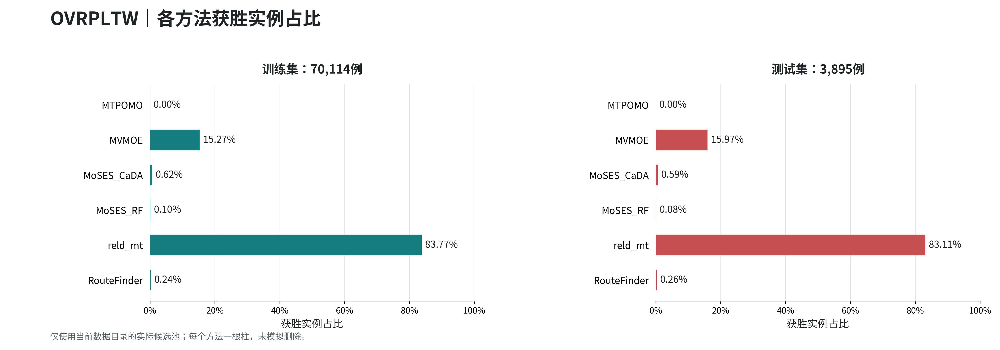

| 方法 | 训练获胜数量 | 训练比例 | 测试获胜数量 | 测试比例 |
| --- | ---: | ---: | ---: | ---: |
| MTPOMO | 0 | 0.00% | 0 | 0.00% |
| MVMOE | 10,709 | 15.27% | 622 | 15.97% |
| MoSES_CaDA | 432 | 0.62% | 23 | 0.59% |
| MoSES_RF | 71 | 0.10% | 3 | 0.08% |
| reld_mt | 58,737 | 83.77% | 3,237 | 83.11% |
| RouteFinder | 165 | 0.24% | 10 | 0.26% |

[该问题CSV](tables/OVRPLTW.csv) · [本图PDF](figures/OVRPLTW.pdf)

## VRPBLTW

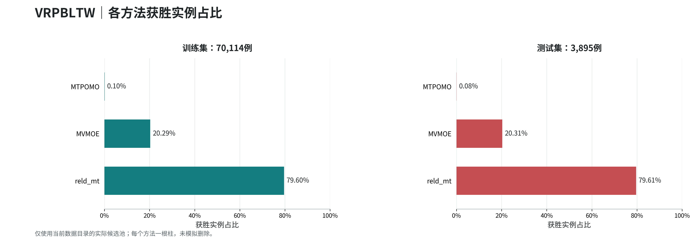

| 方法 | 训练获胜数量 | 训练比例 | 测试获胜数量 | 测试比例 |
| --- | ---: | ---: | ---: | ---: |
| MTPOMO | 72 | 0.10% | 3 | 0.08% |
| MVMOE | 14,228 | 20.29% | 791 | 20.31% |
| reld_mt | 55,814 | 79.60% | 3,101 | 79.61% |

[该问题CSV](tables/VRPBLTW.csv) · [本图PDF](figures/VRPBLTW.pdf)

## OVRPBLTW

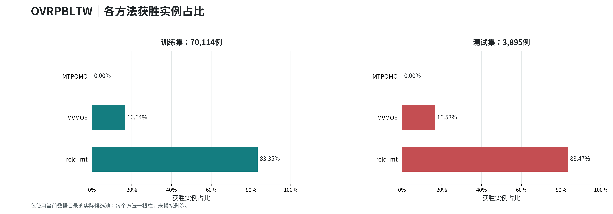

| 方法 | 训练获胜数量 | 训练比例 | 测试获胜数量 | 测试比例 |
| --- | ---: | ---: | ---: | ---: |
| MTPOMO | 3 | 0.00% | 0 | 0.00% |
| MVMOE | 11,669 | 16.64% | 644 | 16.53% |
| reld_mt | 58,442 | 83.35% | 3,251 | 83.47% |

[该问题CSV](tables/OVRPBLTW.csv) · [本图PDF](figures/OVRPBLTW.pdf)

说明：直接使用数据目录已有的获胜计数，没有加载模型、重新求解、改动数据或重新划分。精确并列沿用该数据发布时的winner规则。
