# 18种问题：训练集各方法获胜实例占比

只统计训练集，每种问题10,000例。各问题独立展示，不混合汇总。

每个问题分为三套独立图表：原候选池、只删除RELD_MTL、只删除RELD_MOEL。每张图中，每个方法只有一根柱，横轴统一为0–100%。

表格分别列出获胜数量和比例，每张表的获胜数量合计10,000。被删除的方法不参与对应图表。

Top1分布是方法成为真实winner的比例，不是选择模型准确率。原池沿用原标签；删除时仅将被删方法的winner按剩余FP64成本重新分配，完全并列按原成本列顺序。原数据未修改。

[下载54页训练集图表PDF](winner_distributions_train.pdf) · [下载训练集图表包](per_problem_bundle.zip) · [全部训练集CSV](train_winner_distribution.csv)

**问题目录：** [TSP](#tsp) · [CVRP](#cvrp) · [ATSP](#atsp) · [OVRP](#ovrp) · [VRPB](#vrpb) · [VRPL](#vrpl) · [VRPTW](#vrptw) · [OVRPTW](#ovrptw) · [OVRPB](#ovrpb) · [OVRPL](#ovrpl) · [VRPBL](#vrpbl) · [VRPBTW](#vrpbtw) · [VRPLTW](#vrpltw) · [OVRPBL](#ovrpbl) · [OVRPBTW](#ovrpbtw) · [OVRPLTW](#ovrpltw) · [VRPBLTW](#vrpbltw) · [OVRPBLTW](#ovrpbltw)

## TSP

### 原候选池

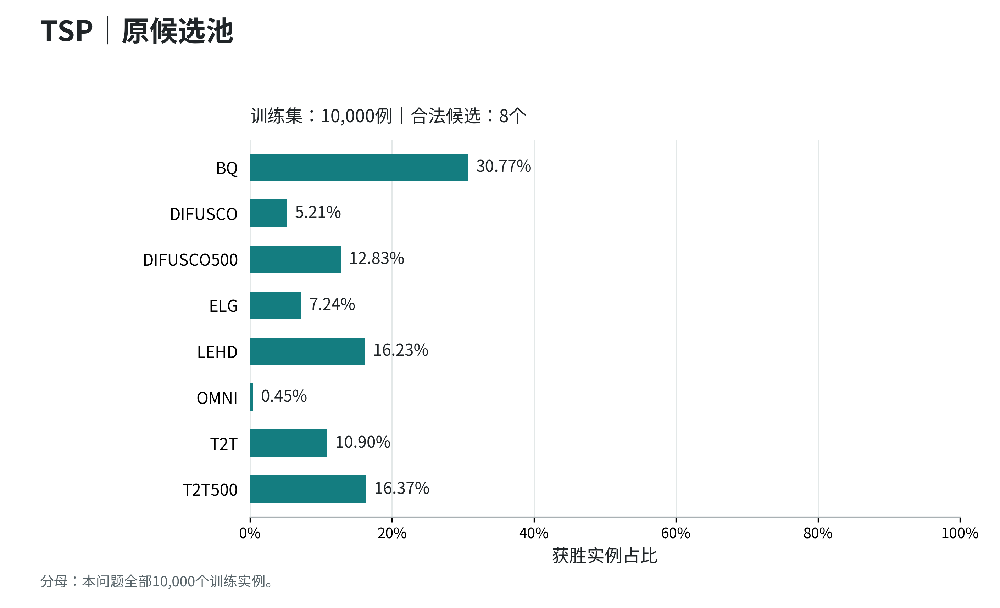

| 方法 | 获胜数量 | 占训练实例比例 |
| --- | ---: | ---: |
| BQ | 3,077 | 30.77% |
| DIFUSCO | 521 | 5.21% |
| DIFUSCO500 | 1,283 | 12.83% |
| ELG | 724 | 7.24% |
| LEHD | 1,623 | 16.23% |
| OMNI | 45 | 0.45% |
| T2T | 1,090 | 10.90% |
| T2T500 | 1,637 | 16.37% |

[本情况CSV](tables_train/TSP_original.csv) · [本图PDF](figures_train/TSP_original.pdf)

### 只删除 RELD_MTL

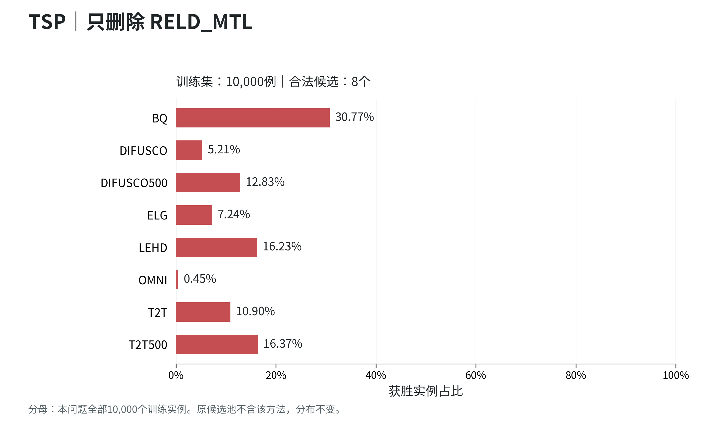

| 方法 | 获胜数量 | 占训练实例比例 |
| --- | ---: | ---: |
| BQ | 3,077 | 30.77% |
| DIFUSCO | 521 | 5.21% |
| DIFUSCO500 | 1,283 | 12.83% |
| ELG | 724 | 7.24% |
| LEHD | 1,623 | 16.23% |
| OMNI | 45 | 0.45% |
| T2T | 1,090 | 10.90% |
| T2T500 | 1,637 | 16.37% |

[本情况CSV](tables_train/TSP_without_RELD_MTL.csv) · [本图PDF](figures_train/TSP_without_RELD_MTL.pdf)

### 只删除 RELD_MOEL

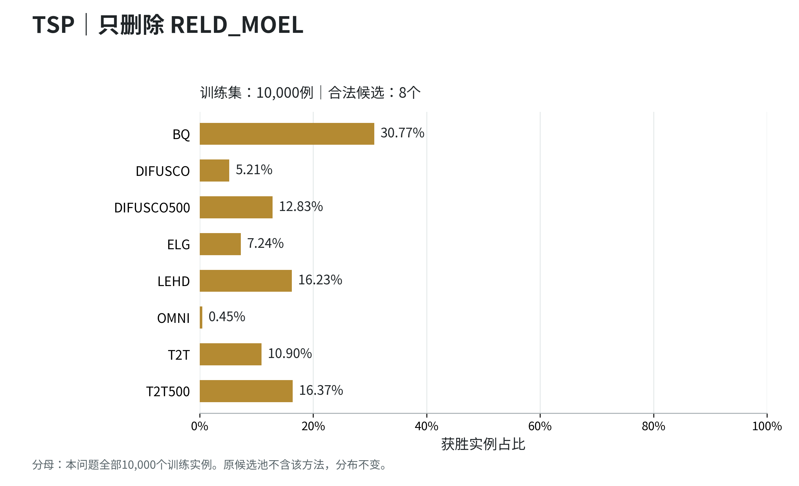

| 方法 | 获胜数量 | 占训练实例比例 |
| --- | ---: | ---: |
| BQ | 3,077 | 30.77% |
| DIFUSCO | 521 | 5.21% |
| DIFUSCO500 | 1,283 | 12.83% |
| ELG | 724 | 7.24% |
| LEHD | 1,623 | 16.23% |
| OMNI | 45 | 0.45% |
| T2T | 1,090 | 10.90% |
| T2T500 | 1,637 | 16.37% |

[本情况CSV](tables_train/TSP_without_RELD_MOEL.csv) · [本图PDF](figures_train/TSP_without_RELD_MOEL.pdf)

## CVRP

### 原候选池

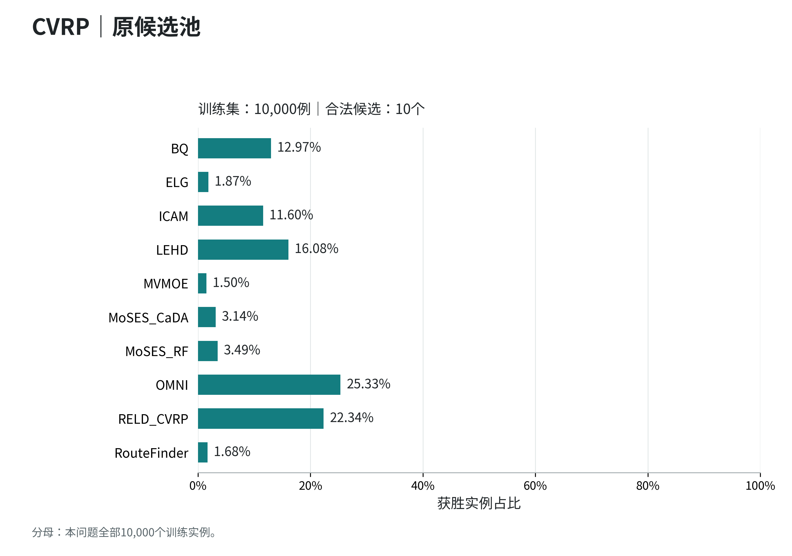

| 方法 | 获胜数量 | 占训练实例比例 |
| --- | ---: | ---: |
| BQ | 1,297 | 12.97% |
| ELG | 187 | 1.87% |
| ICAM | 1,160 | 11.60% |
| LEHD | 1,608 | 16.08% |
| MVMOE | 150 | 1.50% |
| MoSES_CaDA | 314 | 3.14% |
| MoSES_RF | 349 | 3.49% |
| OMNI | 2,533 | 25.33% |
| RELD_CVRP | 2,234 | 22.34% |
| RouteFinder | 168 | 1.68% |

[本情况CSV](tables_train/CVRP_original.csv) · [本图PDF](figures_train/CVRP_original.pdf)

### 只删除 RELD_MTL

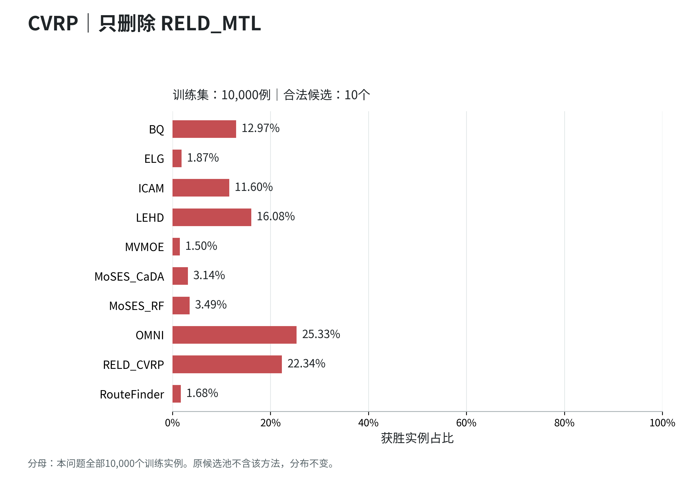

| 方法 | 获胜数量 | 占训练实例比例 |
| --- | ---: | ---: |
| BQ | 1,297 | 12.97% |
| ELG | 187 | 1.87% |
| ICAM | 1,160 | 11.60% |
| LEHD | 1,608 | 16.08% |
| MVMOE | 150 | 1.50% |
| MoSES_CaDA | 314 | 3.14% |
| MoSES_RF | 349 | 3.49% |
| OMNI | 2,533 | 25.33% |
| RELD_CVRP | 2,234 | 22.34% |
| RouteFinder | 168 | 1.68% |

[本情况CSV](tables_train/CVRP_without_RELD_MTL.csv) · [本图PDF](figures_train/CVRP_without_RELD_MTL.pdf)

### 只删除 RELD_MOEL

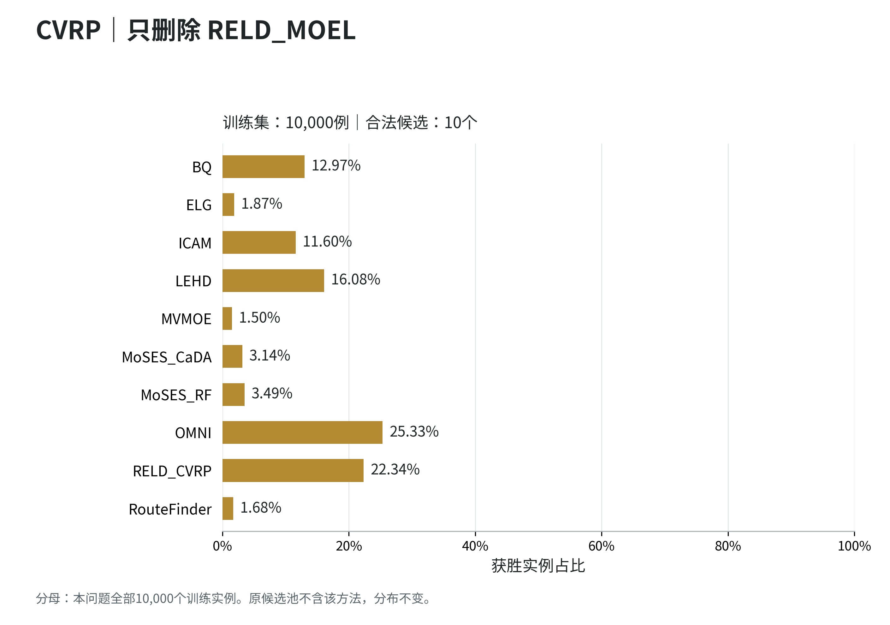

| 方法 | 获胜数量 | 占训练实例比例 |
| --- | ---: | ---: |
| BQ | 1,297 | 12.97% |
| ELG | 187 | 1.87% |
| ICAM | 1,160 | 11.60% |
| LEHD | 1,608 | 16.08% |
| MVMOE | 150 | 1.50% |
| MoSES_CaDA | 314 | 3.14% |
| MoSES_RF | 349 | 3.49% |
| OMNI | 2,533 | 25.33% |
| RELD_CVRP | 2,234 | 22.34% |
| RouteFinder | 168 | 1.68% |

[本情况CSV](tables_train/CVRP_without_RELD_MOEL.csv) · [本图PDF](figures_train/CVRP_without_RELD_MOEL.pdf)

## ATSP

### 原候选池

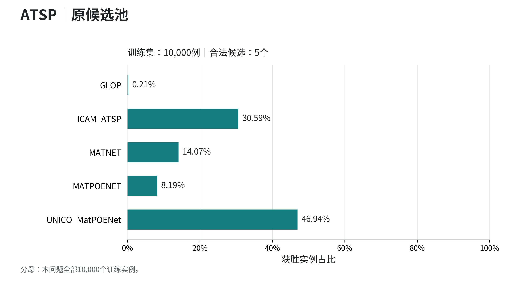

| 方法 | 获胜数量 | 占训练实例比例 |
| --- | ---: | ---: |
| GLOP | 21 | 0.21% |
| ICAM_ATSP | 3,059 | 30.59% |
| MATNET | 1,407 | 14.07% |
| MATPOENET | 819 | 8.19% |
| UNICO_MatPOENet | 4,694 | 46.94% |

[本情况CSV](tables_train/ATSP_original.csv) · [本图PDF](figures_train/ATSP_original.pdf)

### 只删除 RELD_MTL

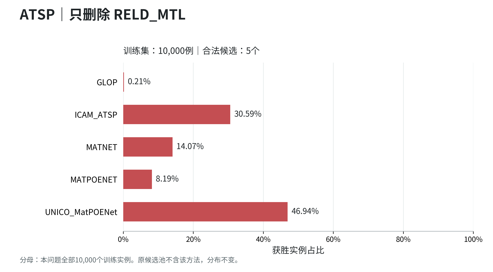

| 方法 | 获胜数量 | 占训练实例比例 |
| --- | ---: | ---: |
| GLOP | 21 | 0.21% |
| ICAM_ATSP | 3,059 | 30.59% |
| MATNET | 1,407 | 14.07% |
| MATPOENET | 819 | 8.19% |
| UNICO_MatPOENet | 4,694 | 46.94% |

[本情况CSV](tables_train/ATSP_without_RELD_MTL.csv) · [本图PDF](figures_train/ATSP_without_RELD_MTL.pdf)

### 只删除 RELD_MOEL

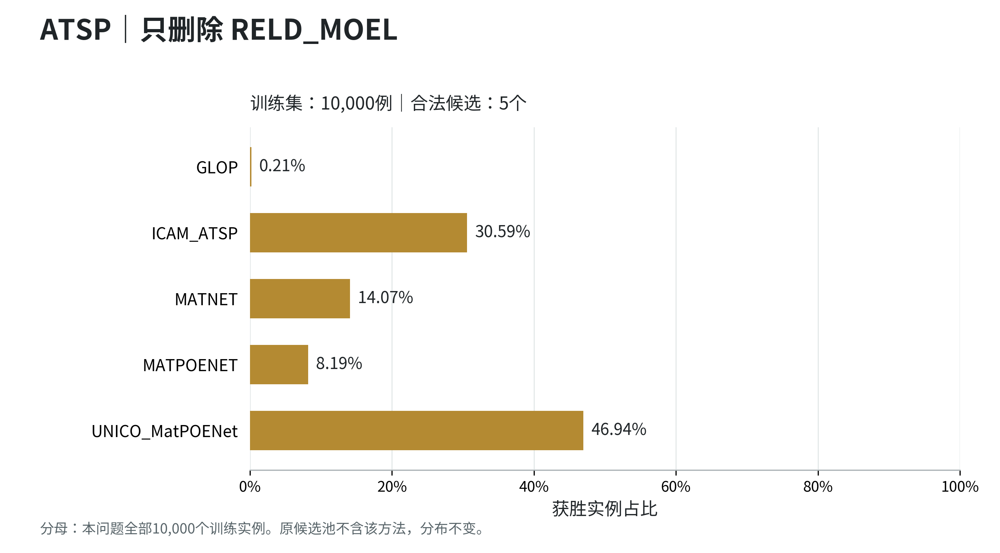

| 方法 | 获胜数量 | 占训练实例比例 |
| --- | ---: | ---: |
| GLOP | 21 | 0.21% |
| ICAM_ATSP | 3,059 | 30.59% |
| MATNET | 1,407 | 14.07% |
| MATPOENET | 819 | 8.19% |
| UNICO_MatPOENet | 4,694 | 46.94% |

[本情况CSV](tables_train/ATSP_without_RELD_MOEL.csv) · [本图PDF](figures_train/ATSP_without_RELD_MOEL.pdf)

## OVRP

### 原候选池

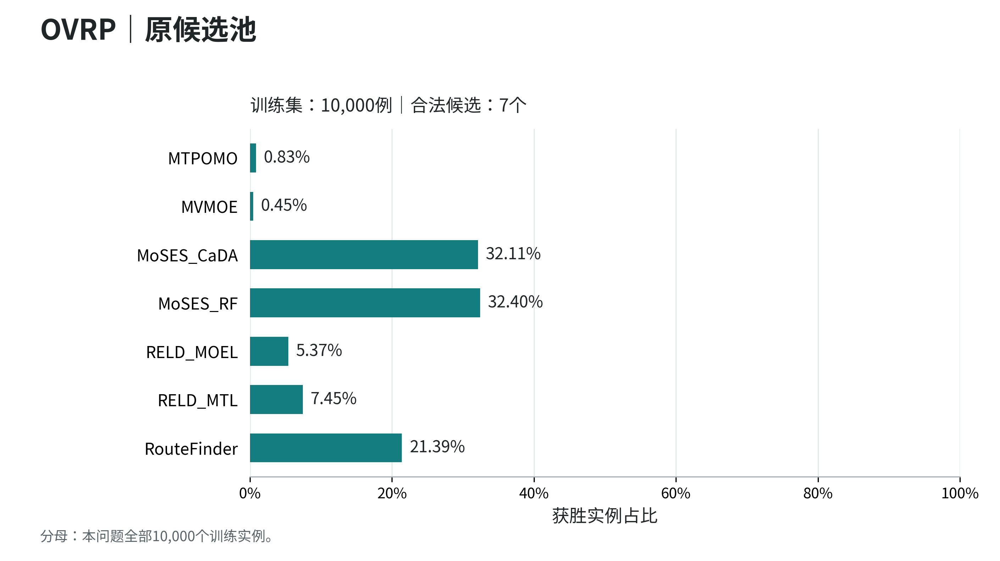

| 方法 | 获胜数量 | 占训练实例比例 |
| --- | ---: | ---: |
| MTPOMO | 83 | 0.83% |
| MVMOE | 45 | 0.45% |
| MoSES_CaDA | 3,211 | 32.11% |
| MoSES_RF | 3,240 | 32.40% |
| RELD_MOEL | 537 | 5.37% |
| RELD_MTL | 745 | 7.45% |
| RouteFinder | 2,139 | 21.39% |

[本情况CSV](tables_train/OVRP_original.csv) · [本图PDF](figures_train/OVRP_original.pdf)

### 只删除 RELD_MTL

| 方法 | 获胜数量 | 占训练实例比例 |
| --- | ---: | ---: |
| MTPOMO | 91 | 0.91% |
| MVMOE | 57 | 0.57% |
| MoSES_CaDA | 3,447 | 34.47% |
| MoSES_RF | 3,475 | 34.75% |
| RELD_MOEL | 608 | 6.08% |
| RouteFinder | 2,322 | 23.22% |

[本情况CSV](tables_train/OVRP_without_RELD_MTL.csv) · [本图PDF](figures_train/OVRP_without_RELD_MTL.pdf)

### 只删除 RELD_MOEL

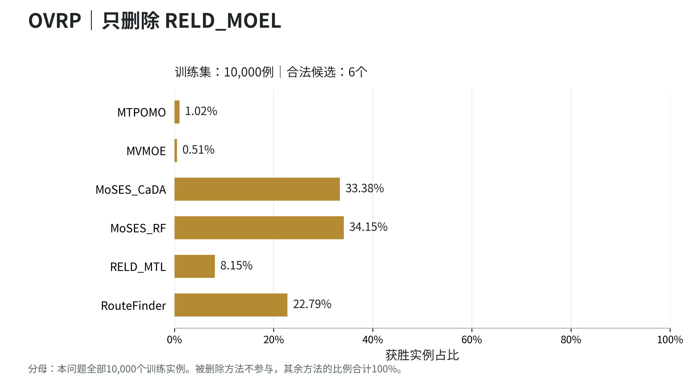

| 方法 | 获胜数量 | 占训练实例比例 |
| --- | ---: | ---: |
| MTPOMO | 102 | 1.02% |
| MVMOE | 51 | 0.51% |
| MoSES_CaDA | 3,338 | 33.38% |
| MoSES_RF | 3,415 | 34.15% |
| RELD_MTL | 815 | 8.15% |
| RouteFinder | 2,279 | 22.79% |

[本情况CSV](tables_train/OVRP_without_RELD_MOEL.csv) · [本图PDF](figures_train/OVRP_without_RELD_MOEL.pdf)

## VRPB

### 原候选池

| 方法 | 获胜数量 | 占训练实例比例 |
| --- | ---: | ---: |
| MTPOMO | 187 | 1.87% |
| MVMOE | 571 | 5.71% |
| MoSES_CaDA | 5 | 0.05% |
| MoSES_RF | 5 | 0.05% |
| RELD_MOEL | 4,100 | 41.00% |
| RELD_MTL | 5,131 | 51.31% |
| RouteFinder | 1 | 0.01% |

[本情况CSV](tables_train/VRPB_original.csv) · [本图PDF](figures_train/VRPB_original.pdf)

### 只删除 RELD_MTL

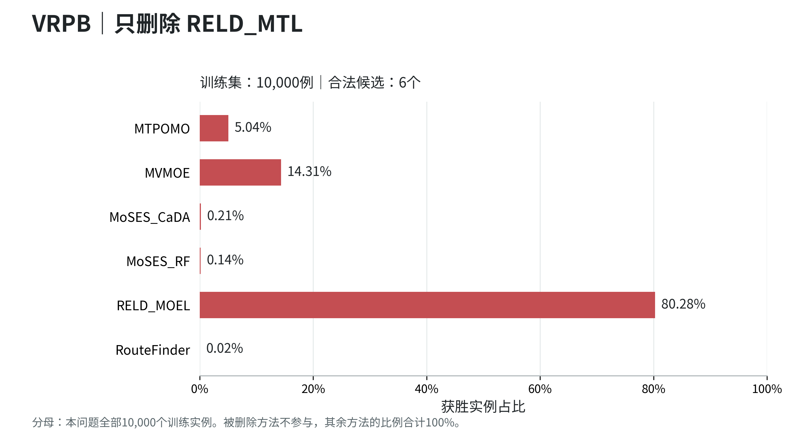

| 方法 | 获胜数量 | 占训练实例比例 |
| --- | ---: | ---: |
| MTPOMO | 504 | 5.04% |
| MVMOE | 1,431 | 14.31% |
| MoSES_CaDA | 21 | 0.21% |
| MoSES_RF | 14 | 0.14% |
| RELD_MOEL | 8,028 | 80.28% |
| RouteFinder | 2 | 0.02% |

[本情况CSV](tables_train/VRPB_without_RELD_MTL.csv) · [本图PDF](figures_train/VRPB_without_RELD_MTL.pdf)

### 只删除 RELD_MOEL

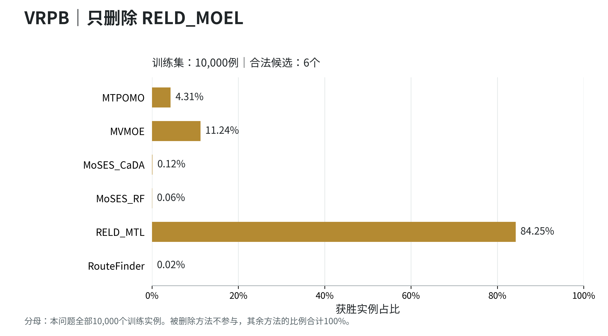

| 方法 | 获胜数量 | 占训练实例比例 |
| --- | ---: | ---: |
| MTPOMO | 431 | 4.31% |
| MVMOE | 1,124 | 11.24% |
| MoSES_CaDA | 12 | 0.12% |
| MoSES_RF | 6 | 0.06% |
| RELD_MTL | 8,425 | 84.25% |
| RouteFinder | 2 | 0.02% |

[本情况CSV](tables_train/VRPB_without_RELD_MOEL.csv) · [本图PDF](figures_train/VRPB_without_RELD_MOEL.pdf)

## VRPL

### 原候选池

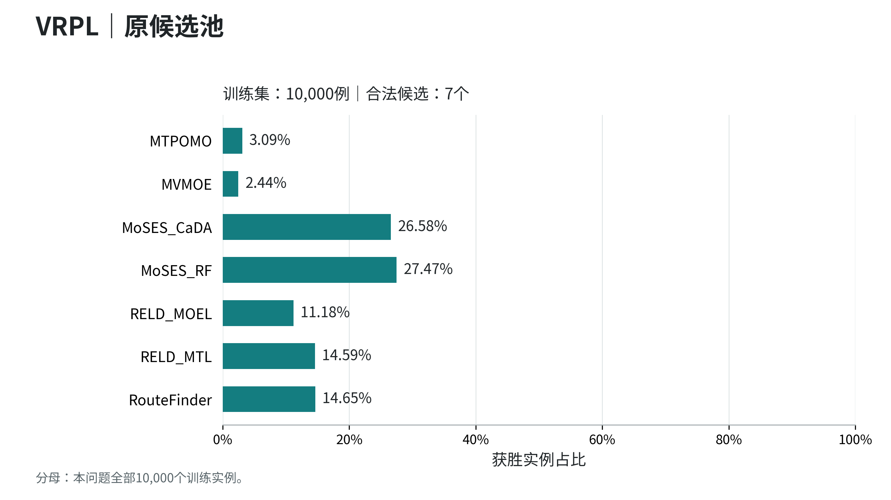

| 方法 | 获胜数量 | 占训练实例比例 |
| --- | ---: | ---: |
| MTPOMO | 309 | 3.09% |
| MVMOE | 244 | 2.44% |
| MoSES_CaDA | 2,658 | 26.58% |
| MoSES_RF | 2,747 | 27.47% |
| RELD_MOEL | 1,118 | 11.18% |
| RELD_MTL | 1,459 | 14.59% |
| RouteFinder | 1,465 | 14.65% |

[本情况CSV](tables_train/VRPL_original.csv) · [本图PDF](figures_train/VRPL_original.pdf)

### 只删除 RELD_MTL

| 方法 | 获胜数量 | 占训练实例比例 |
| --- | ---: | ---: |
| MTPOMO | 369 | 3.69% |
| MVMOE | 328 | 3.28% |
| MoSES_CaDA | 3,061 | 30.61% |
| MoSES_RF | 3,181 | 31.81% |
| RELD_MOEL | 1,353 | 13.53% |
| RouteFinder | 1,708 | 17.08% |

[本情况CSV](tables_train/VRPL_without_RELD_MTL.csv) · [本图PDF](figures_train/VRPL_without_RELD_MTL.pdf)

### 只删除 RELD_MOEL

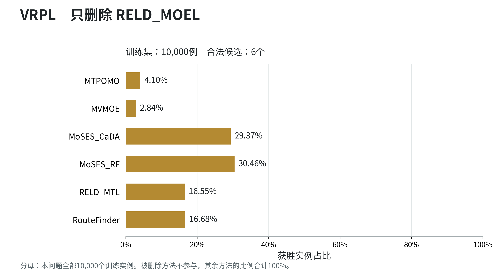

| 方法 | 获胜数量 | 占训练实例比例 |
| --- | ---: | ---: |
| MTPOMO | 410 | 4.10% |
| MVMOE | 284 | 2.84% |
| MoSES_CaDA | 2,937 | 29.37% |
| MoSES_RF | 3,046 | 30.46% |
| RELD_MTL | 1,655 | 16.55% |
| RouteFinder | 1,668 | 16.68% |

[本情况CSV](tables_train/VRPL_without_RELD_MOEL.csv) · [本图PDF](figures_train/VRPL_without_RELD_MOEL.pdf)

## VRPTW

### 原候选池

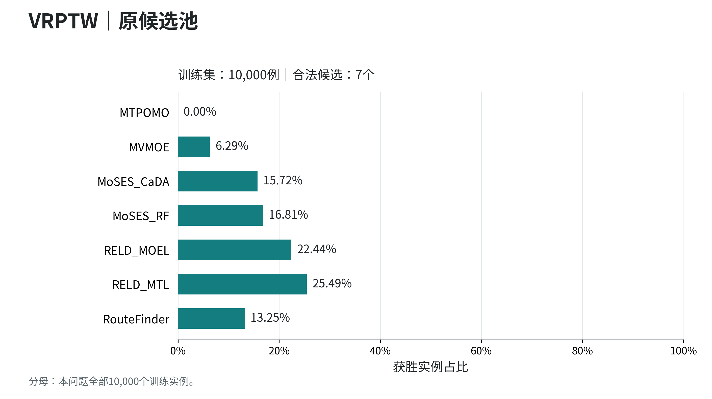

| 方法 | 获胜数量 | 占训练实例比例 |
| --- | ---: | ---: |
| MTPOMO | 0 | 0.00% |
| MVMOE | 629 | 6.29% |
| MoSES_CaDA | 1,572 | 15.72% |
| MoSES_RF | 1,681 | 16.81% |
| RELD_MOEL | 2,244 | 22.44% |
| RELD_MTL | 2,549 | 25.49% |
| RouteFinder | 1,325 | 13.25% |

[本情况CSV](tables_train/VRPTW_original.csv) · [本图PDF](figures_train/VRPTW_original.pdf)

### 只删除 RELD_MTL

| 方法 | 获胜数量 | 占训练实例比例 |
| --- | ---: | ---: |
| MTPOMO | 0 | 0.00% |
| MVMOE | 1,116 | 11.16% |
| MoSES_CaDA | 1,740 | 17.40% |
| MoSES_RF | 1,809 | 18.09% |
| RELD_MOEL | 3,917 | 39.17% |
| RouteFinder | 1,418 | 14.18% |

[本情况CSV](tables_train/VRPTW_without_RELD_MTL.csv) · [本图PDF](figures_train/VRPTW_without_RELD_MTL.pdf)

### 只删除 RELD_MOEL

| 方法 | 获胜数量 | 占训练实例比例 |
| --- | ---: | ---: |
| MTPOMO | 0 | 0.00% |
| MVMOE | 1,052 | 10.52% |
| MoSES_CaDA | 1,689 | 16.89% |
| MoSES_RF | 1,780 | 17.80% |
| RELD_MTL | 4,110 | 41.10% |
| RouteFinder | 1,369 | 13.69% |

[本情况CSV](tables_train/VRPTW_without_RELD_MOEL.csv) · [本图PDF](figures_train/VRPTW_without_RELD_MOEL.pdf)

## OVRPTW

### 原候选池

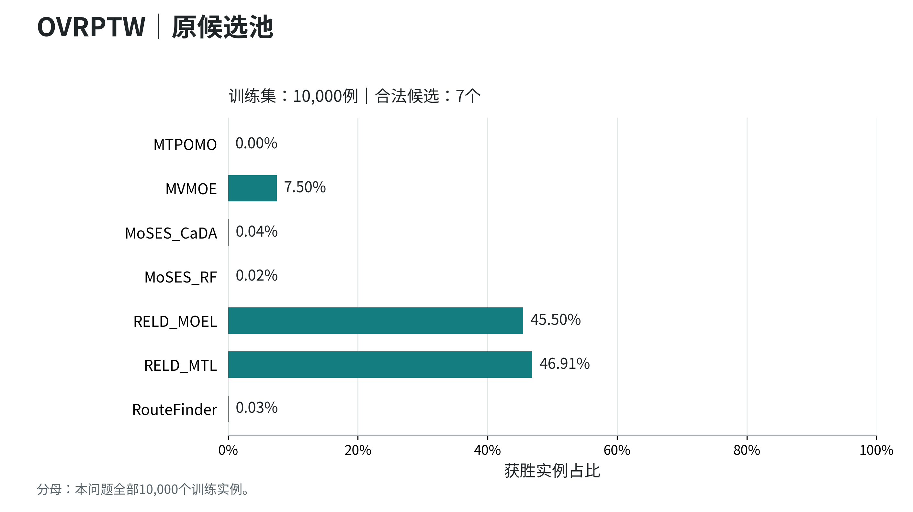

| 方法 | 获胜数量 | 占训练实例比例 |
| --- | ---: | ---: |
| MTPOMO | 0 | 0.00% |
| MVMOE | 750 | 7.50% |
| MoSES_CaDA | 4 | 0.04% |
| MoSES_RF | 2 | 0.02% |
| RELD_MOEL | 4,550 | 45.50% |
| RELD_MTL | 4,691 | 46.91% |
| RouteFinder | 3 | 0.03% |

[本情况CSV](tables_train/OVRPTW_original.csv) · [本图PDF](figures_train/OVRPTW_original.pdf)

### 只删除 RELD_MTL

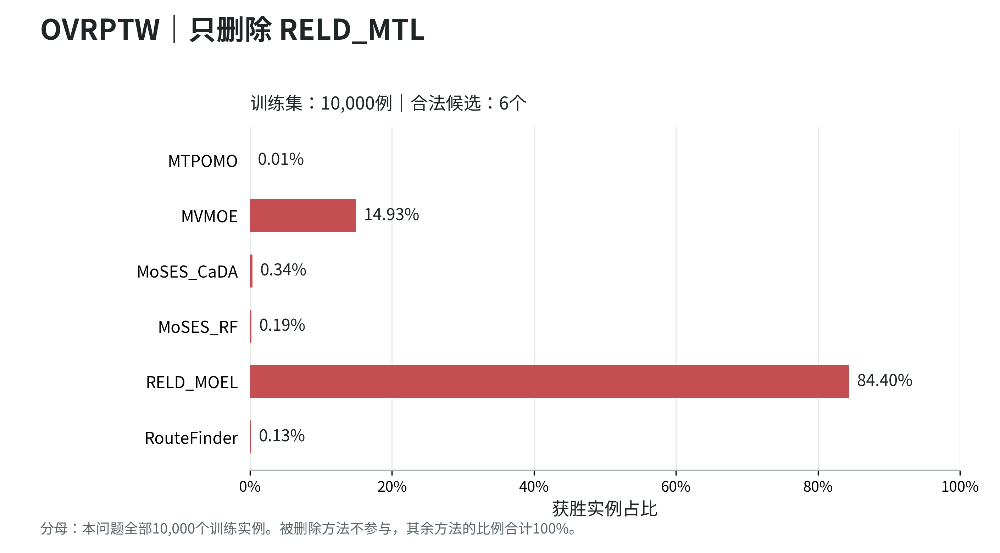

| 方法 | 获胜数量 | 占训练实例比例 |
| --- | ---: | ---: |
| MTPOMO | 1 | 0.01% |
| MVMOE | 1,493 | 14.93% |
| MoSES_CaDA | 34 | 0.34% |
| MoSES_RF | 19 | 0.19% |
| RELD_MOEL | 8,440 | 84.40% |
| RouteFinder | 13 | 0.13% |

[本情况CSV](tables_train/OVRPTW_without_RELD_MTL.csv) · [本图PDF](figures_train/OVRPTW_without_RELD_MTL.pdf)

### 只删除 RELD_MOEL

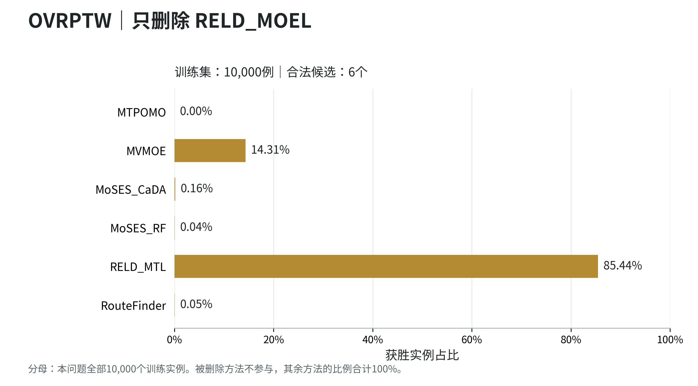

| 方法 | 获胜数量 | 占训练实例比例 |
| --- | ---: | ---: |
| MTPOMO | 0 | 0.00% |
| MVMOE | 1,431 | 14.31% |
| MoSES_CaDA | 16 | 0.16% |
| MoSES_RF | 4 | 0.04% |
| RELD_MTL | 8,544 | 85.44% |
| RouteFinder | 5 | 0.05% |

[本情况CSV](tables_train/OVRPTW_without_RELD_MOEL.csv) · [本图PDF](figures_train/OVRPTW_without_RELD_MOEL.pdf)

## OVRPB

### 原候选池

| 方法 | 获胜数量 | 占训练实例比例 |
| --- | ---: | ---: |
| MTPOMO | 164 | 1.64% |
| MVMOE | 169 | 1.69% |
| MoSES_CaDA | 12 | 0.12% |
| MoSES_RF | 7 | 0.07% |
| RELD_MOEL | 4,252 | 42.52% |
| RELD_MTL | 5,385 | 53.85% |
| RouteFinder | 11 | 0.11% |

[本情况CSV](tables_train/OVRPB_original.csv) · [本图PDF](figures_train/OVRPB_original.pdf)

### 只删除 RELD_MTL

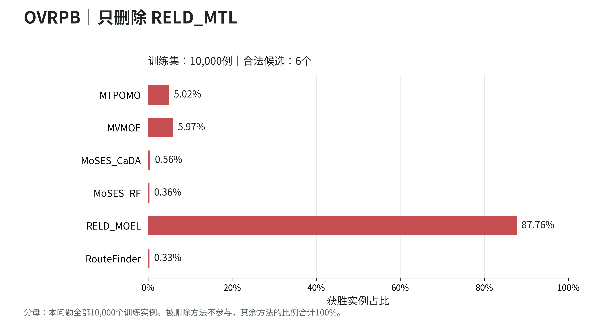

| 方法 | 获胜数量 | 占训练实例比例 |
| --- | ---: | ---: |
| MTPOMO | 502 | 5.02% |
| MVMOE | 597 | 5.97% |
| MoSES_CaDA | 56 | 0.56% |
| MoSES_RF | 36 | 0.36% |
| RELD_MOEL | 8,776 | 87.76% |
| RouteFinder | 33 | 0.33% |

[本情况CSV](tables_train/OVRPB_without_RELD_MTL.csv) · [本图PDF](figures_train/OVRPB_without_RELD_MTL.pdf)

### 只删除 RELD_MOEL

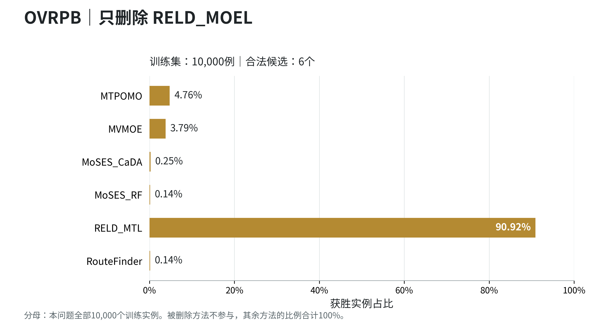

| 方法 | 获胜数量 | 占训练实例比例 |
| --- | ---: | ---: |
| MTPOMO | 476 | 4.76% |
| MVMOE | 379 | 3.79% |
| MoSES_CaDA | 25 | 0.25% |
| MoSES_RF | 14 | 0.14% |
| RELD_MTL | 9,092 | 90.92% |
| RouteFinder | 14 | 0.14% |

[本情况CSV](tables_train/OVRPB_without_RELD_MOEL.csv) · [本图PDF](figures_train/OVRPB_without_RELD_MOEL.pdf)

## OVRPL

### 原候选池

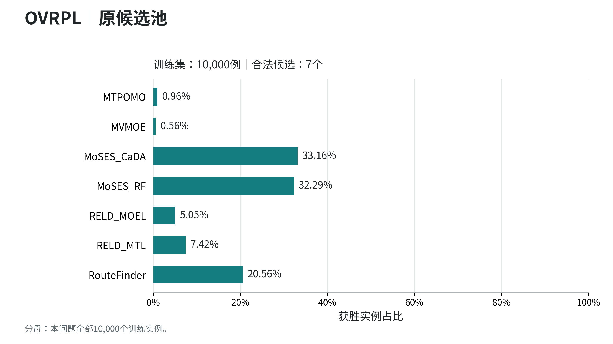

| 方法 | 获胜数量 | 占训练实例比例 |
| --- | ---: | ---: |
| MTPOMO | 96 | 0.96% |
| MVMOE | 56 | 0.56% |
| MoSES_CaDA | 3,316 | 33.16% |
| MoSES_RF | 3,229 | 32.29% |
| RELD_MOEL | 505 | 5.05% |
| RELD_MTL | 742 | 7.42% |
| RouteFinder | 2,056 | 20.56% |

[本情况CSV](tables_train/OVRPL_original.csv) · [本图PDF](figures_train/OVRPL_original.pdf)

### 只删除 RELD_MTL

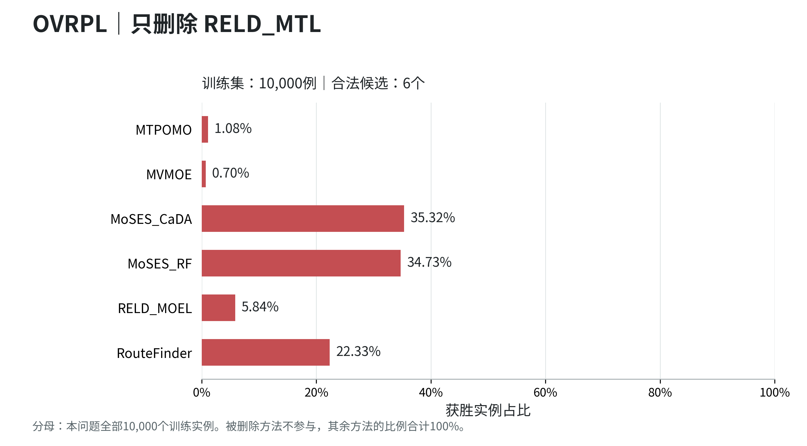

| 方法 | 获胜数量 | 占训练实例比例 |
| --- | ---: | ---: |
| MTPOMO | 108 | 1.08% |
| MVMOE | 70 | 0.70% |
| MoSES_CaDA | 3,532 | 35.32% |
| MoSES_RF | 3,473 | 34.73% |
| RELD_MOEL | 584 | 5.84% |
| RouteFinder | 2,233 | 22.33% |

[本情况CSV](tables_train/OVRPL_without_RELD_MTL.csv) · [本图PDF](figures_train/OVRPL_without_RELD_MTL.pdf)

### 只删除 RELD_MOEL

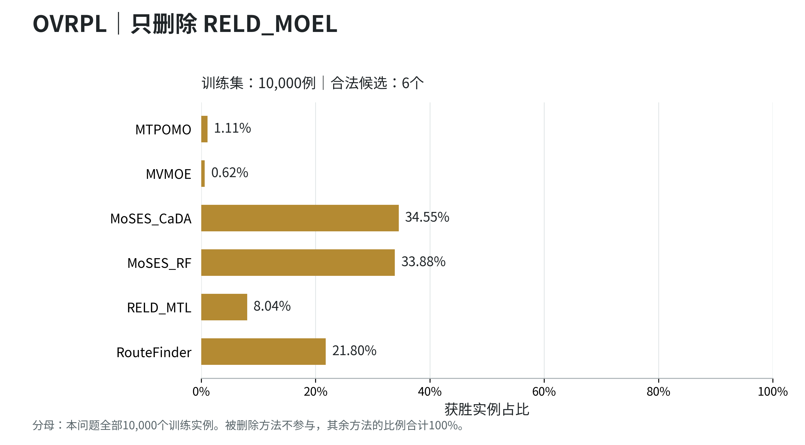

| 方法 | 获胜数量 | 占训练实例比例 |
| --- | ---: | ---: |
| MTPOMO | 111 | 1.11% |
| MVMOE | 62 | 0.62% |
| MoSES_CaDA | 3,455 | 34.55% |
| MoSES_RF | 3,388 | 33.88% |
| RELD_MTL | 804 | 8.04% |
| RouteFinder | 2,180 | 21.80% |

[本情况CSV](tables_train/OVRPL_without_RELD_MOEL.csv) · [本图PDF](figures_train/OVRPL_without_RELD_MOEL.pdf)

## VRPBL

### 原候选池

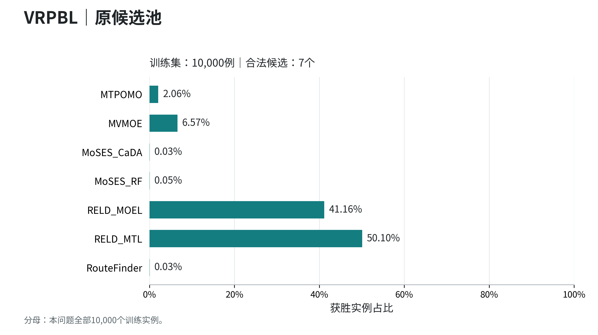

| 方法 | 获胜数量 | 占训练实例比例 |
| --- | ---: | ---: |
| MTPOMO | 206 | 2.06% |
| MVMOE | 657 | 6.57% |
| MoSES_CaDA | 3 | 0.03% |
| MoSES_RF | 5 | 0.05% |
| RELD_MOEL | 4,116 | 41.16% |
| RELD_MTL | 5,010 | 50.10% |
| RouteFinder | 3 | 0.03% |

[本情况CSV](tables_train/VRPBL_original.csv) · [本图PDF](figures_train/VRPBL_original.pdf)

### 只删除 RELD_MTL

| 方法 | 获胜数量 | 占训练实例比例 |
| --- | ---: | ---: |
| MTPOMO | 514 | 5.14% |
| MVMOE | 1,531 | 15.31% |
| MoSES_CaDA | 19 | 0.19% |
| MoSES_RF | 16 | 0.16% |
| RELD_MOEL | 7,911 | 79.11% |
| RouteFinder | 9 | 0.09% |

[本情况CSV](tables_train/VRPBL_without_RELD_MTL.csv) · [本图PDF](figures_train/VRPBL_without_RELD_MTL.pdf)

### 只删除 RELD_MOEL

| 方法 | 获胜数量 | 占训练实例比例 |
| --- | ---: | ---: |
| MTPOMO | 432 | 4.32% |
| MVMOE | 1,181 | 11.81% |
| MoSES_CaDA | 5 | 0.05% |
| MoSES_RF | 7 | 0.07% |
| RELD_MTL | 8,369 | 83.69% |
| RouteFinder | 6 | 0.06% |

[本情况CSV](tables_train/VRPBL_without_RELD_MOEL.csv) · [本图PDF](figures_train/VRPBL_without_RELD_MOEL.pdf)

## VRPBTW

### 原候选池

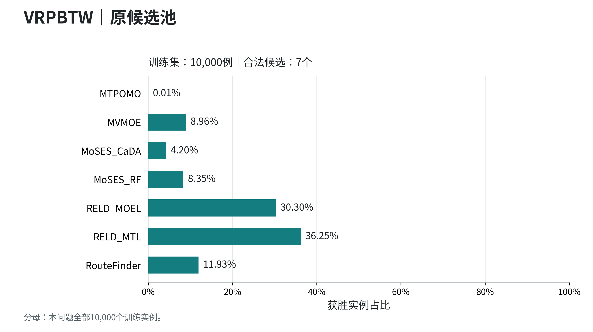

| 方法 | 获胜数量 | 占训练实例比例 |
| --- | ---: | ---: |
| MTPOMO | 1 | 0.01% |
| MVMOE | 896 | 8.96% |
| MoSES_CaDA | 420 | 4.20% |
| MoSES_RF | 835 | 8.35% |
| RELD_MOEL | 3,030 | 30.30% |
| RELD_MTL | 3,625 | 36.25% |
| RouteFinder | 1,193 | 11.93% |

[本情况CSV](tables_train/VRPBTW_original.csv) · [本图PDF](figures_train/VRPBTW_original.pdf)

### 只删除 RELD_MTL

| 方法 | 获胜数量 | 占训练实例比例 |
| --- | ---: | ---: |
| MTPOMO | 2 | 0.02% |
| MVMOE | 1,627 | 16.27% |
| MoSES_CaDA | 511 | 5.11% |
| MoSES_RF | 977 | 9.77% |
| RELD_MOEL | 5,555 | 55.55% |
| RouteFinder | 1,328 | 13.28% |

[本情况CSV](tables_train/VRPBTW_without_RELD_MTL.csv) · [本图PDF](figures_train/VRPBTW_without_RELD_MTL.pdf)

### 只删除 RELD_MOEL

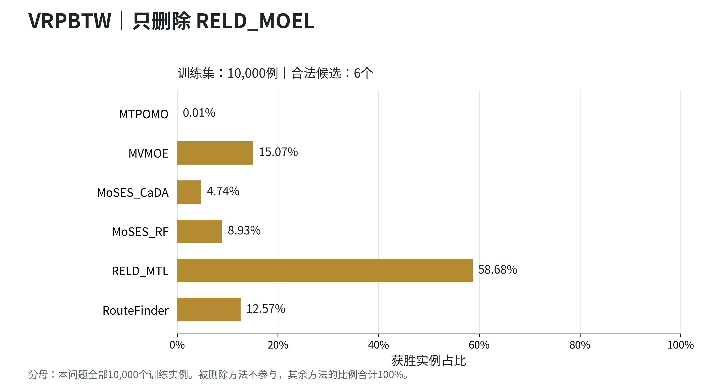

| 方法 | 获胜数量 | 占训练实例比例 |
| --- | ---: | ---: |
| MTPOMO | 1 | 0.01% |
| MVMOE | 1,507 | 15.07% |
| MoSES_CaDA | 474 | 4.74% |
| MoSES_RF | 893 | 8.93% |
| RELD_MTL | 5,868 | 58.68% |
| RouteFinder | 1,257 | 12.57% |

[本情况CSV](tables_train/VRPBTW_without_RELD_MOEL.csv) · [本图PDF](figures_train/VRPBTW_without_RELD_MOEL.pdf)

## VRPLTW

### 原候选池

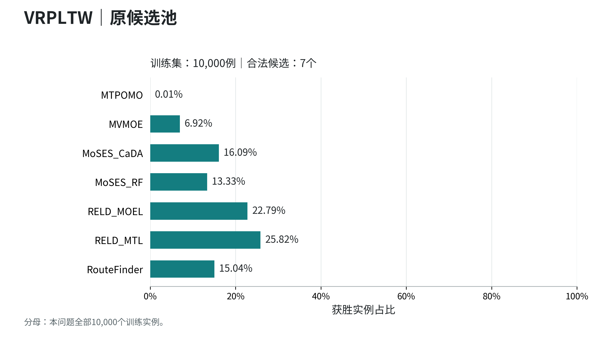

| 方法 | 获胜数量 | 占训练实例比例 |
| --- | ---: | ---: |
| MTPOMO | 1 | 0.01% |
| MVMOE | 692 | 6.92% |
| MoSES_CaDA | 1,609 | 16.09% |
| MoSES_RF | 1,333 | 13.33% |
| RELD_MOEL | 2,279 | 22.79% |
| RELD_MTL | 2,582 | 25.82% |
| RouteFinder | 1,504 | 15.04% |

[本情况CSV](tables_train/VRPLTW_original.csv) · [本图PDF](figures_train/VRPLTW_original.pdf)

### 只删除 RELD_MTL

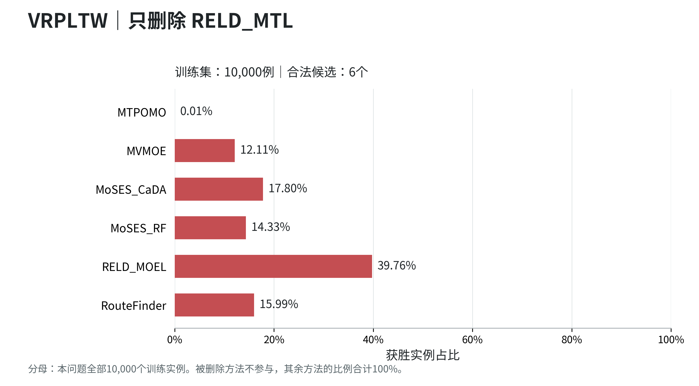

| 方法 | 获胜数量 | 占训练实例比例 |
| --- | ---: | ---: |
| MTPOMO | 1 | 0.01% |
| MVMOE | 1,211 | 12.11% |
| MoSES_CaDA | 1,780 | 17.80% |
| MoSES_RF | 1,433 | 14.33% |
| RELD_MOEL | 3,976 | 39.76% |
| RouteFinder | 1,599 | 15.99% |

[本情况CSV](tables_train/VRPLTW_without_RELD_MTL.csv) · [本图PDF](figures_train/VRPLTW_without_RELD_MTL.pdf)

### 只删除 RELD_MOEL

| 方法 | 获胜数量 | 占训练实例比例 |
| --- | ---: | ---: |
| MTPOMO | 1 | 0.01% |
| MVMOE | 1,136 | 11.36% |
| MoSES_CaDA | 1,719 | 17.19% |
| MoSES_RF | 1,394 | 13.94% |
| RELD_MTL | 4,179 | 41.79% |
| RouteFinder | 1,571 | 15.71% |

[本情况CSV](tables_train/VRPLTW_without_RELD_MOEL.csv) · [本图PDF](figures_train/VRPLTW_without_RELD_MOEL.pdf)

## OVRPBL

### 原候选池

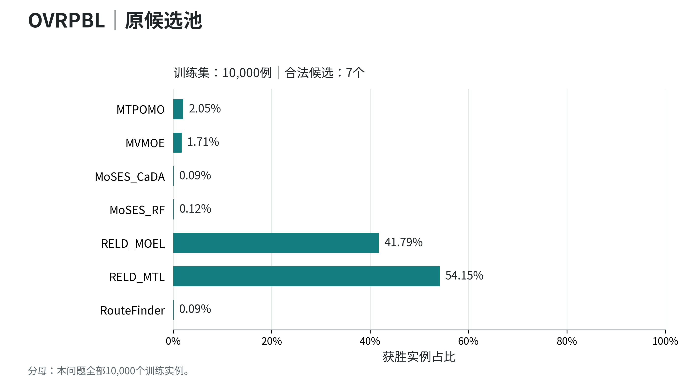

| 方法 | 获胜数量 | 占训练实例比例 |
| --- | ---: | ---: |
| MTPOMO | 205 | 2.05% |
| MVMOE | 171 | 1.71% |
| MoSES_CaDA | 9 | 0.09% |
| MoSES_RF | 12 | 0.12% |
| RELD_MOEL | 4,179 | 41.79% |
| RELD_MTL | 5,415 | 54.15% |
| RouteFinder | 9 | 0.09% |

[本情况CSV](tables_train/OVRPBL_original.csv) · [本图PDF](figures_train/OVRPBL_original.pdf)

### 只删除 RELD_MTL

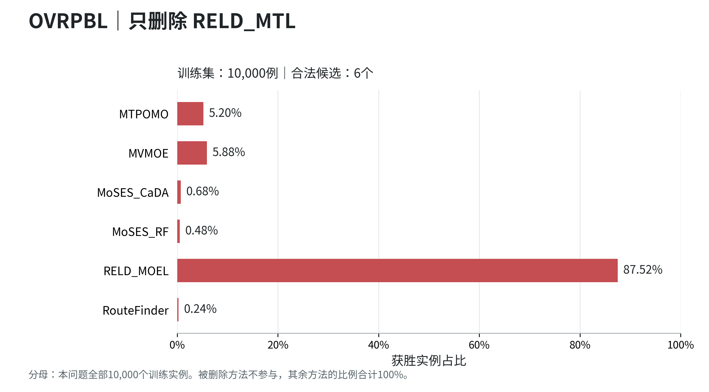

| 方法 | 获胜数量 | 占训练实例比例 |
| --- | ---: | ---: |
| MTPOMO | 520 | 5.20% |
| MVMOE | 588 | 5.88% |
| MoSES_CaDA | 68 | 0.68% |
| MoSES_RF | 48 | 0.48% |
| RELD_MOEL | 8,752 | 87.52% |
| RouteFinder | 24 | 0.24% |

[本情况CSV](tables_train/OVRPBL_without_RELD_MTL.csv) · [本图PDF](figures_train/OVRPBL_without_RELD_MTL.pdf)

### 只删除 RELD_MOEL

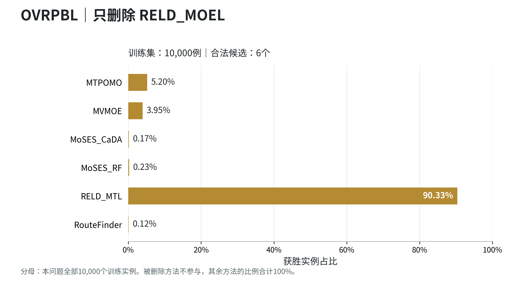

| 方法 | 获胜数量 | 占训练实例比例 |
| --- | ---: | ---: |
| MTPOMO | 520 | 5.20% |
| MVMOE | 395 | 3.95% |
| MoSES_CaDA | 17 | 0.17% |
| MoSES_RF | 23 | 0.23% |
| RELD_MTL | 9,033 | 90.33% |
| RouteFinder | 12 | 0.12% |

[本情况CSV](tables_train/OVRPBL_without_RELD_MOEL.csv) · [本图PDF](figures_train/OVRPBL_without_RELD_MOEL.pdf)

## OVRPBTW

### 原候选池

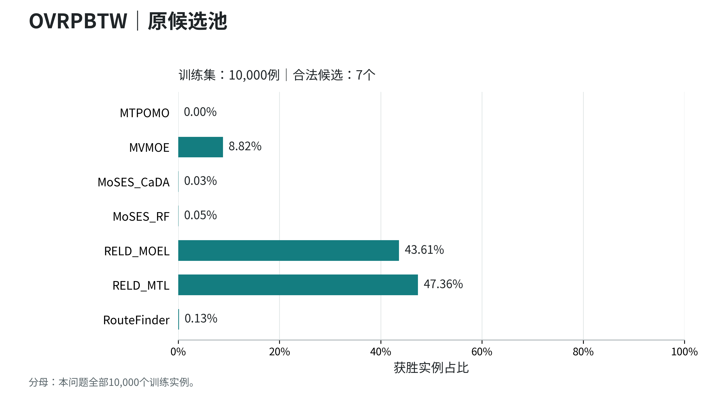

| 方法 | 获胜数量 | 占训练实例比例 |
| --- | ---: | ---: |
| MTPOMO | 0 | 0.00% |
| MVMOE | 882 | 8.82% |
| MoSES_CaDA | 3 | 0.03% |
| MoSES_RF | 5 | 0.05% |
| RELD_MOEL | 4,361 | 43.61% |
| RELD_MTL | 4,736 | 47.36% |
| RouteFinder | 13 | 0.13% |

[本情况CSV](tables_train/OVRPBTW_original.csv) · [本图PDF](figures_train/OVRPBTW_original.pdf)

### 只删除 RELD_MTL

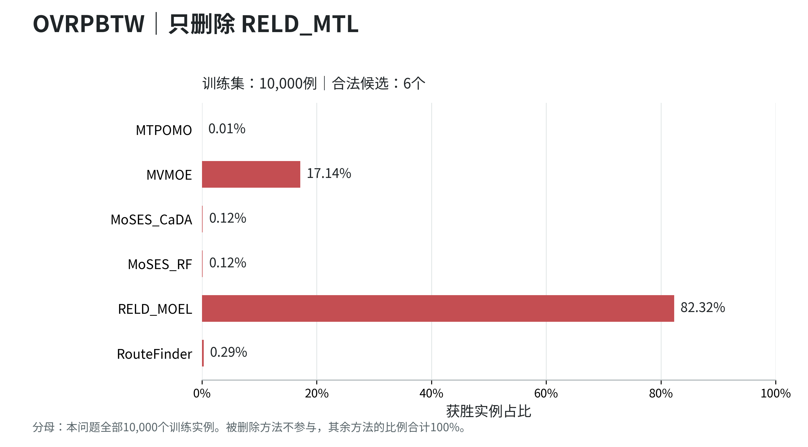

| 方法 | 获胜数量 | 占训练实例比例 |
| --- | ---: | ---: |
| MTPOMO | 1 | 0.01% |
| MVMOE | 1,714 | 17.14% |
| MoSES_CaDA | 12 | 0.12% |
| MoSES_RF | 12 | 0.12% |
| RELD_MOEL | 8,232 | 82.32% |
| RouteFinder | 29 | 0.29% |

[本情况CSV](tables_train/OVRPBTW_without_RELD_MTL.csv) · [本图PDF](figures_train/OVRPBTW_without_RELD_MTL.pdf)

### 只删除 RELD_MOEL

| 方法 | 获胜数量 | 占训练实例比例 |
| --- | ---: | ---: |
| MTPOMO | 0 | 0.00% |
| MVMOE | 1,610 | 16.10% |
| MoSES_CaDA | 5 | 0.05% |
| MoSES_RF | 7 | 0.07% |
| RELD_MTL | 8,352 | 83.52% |
| RouteFinder | 26 | 0.26% |

[本情况CSV](tables_train/OVRPBTW_without_RELD_MOEL.csv) · [本图PDF](figures_train/OVRPBTW_without_RELD_MOEL.pdf)

## OVRPLTW

### 原候选池

| 方法 | 获胜数量 | 占训练实例比例 |
| --- | ---: | ---: |
| MTPOMO | 0 | 0.00% |
| MVMOE | 766 | 7.66% |
| MoSES_CaDA | 12 | 0.12% |
| MoSES_RF | 0 | 0.00% |
| RELD_MOEL | 4,458 | 44.58% |
| RELD_MTL | 4,764 | 47.64% |
| RouteFinder | 0 | 0.00% |

[本情况CSV](tables_train/OVRPLTW_original.csv) · [本图PDF](figures_train/OVRPLTW_original.pdf)

### 只删除 RELD_MTL

| 方法 | 获胜数量 | 占训练实例比例 |
| --- | ---: | ---: |
| MTPOMO | 0 | 0.00% |
| MVMOE | 1,528 | 15.28% |
| MoSES_CaDA | 55 | 0.55% |
| MoSES_RF | 10 | 0.10% |
| RELD_MOEL | 8,385 | 83.85% |
| RouteFinder | 22 | 0.22% |

[本情况CSV](tables_train/OVRPLTW_without_RELD_MTL.csv) · [本图PDF](figures_train/OVRPLTW_without_RELD_MTL.pdf)

### 只删除 RELD_MOEL

| 方法 | 获胜数量 | 占训练实例比例 |
| --- | ---: | ---: |
| MTPOMO | 0 | 0.00% |
| MVMOE | 1,444 | 14.44% |
| MoSES_CaDA | 27 | 0.27% |
| MoSES_RF | 3 | 0.03% |
| RELD_MTL | 8,517 | 85.17% |
| RouteFinder | 9 | 0.09% |

[本情况CSV](tables_train/OVRPLTW_without_RELD_MOEL.csv) · [本图PDF](figures_train/OVRPLTW_without_RELD_MOEL.pdf)

## VRPBLTW

### 原候选池

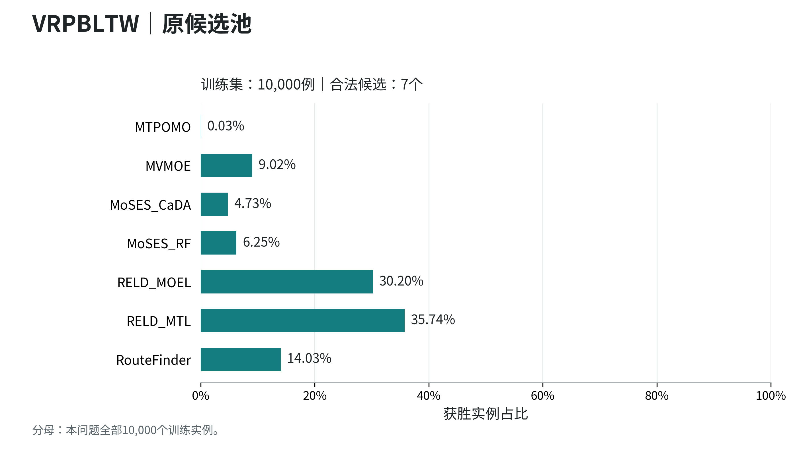

| 方法 | 获胜数量 | 占训练实例比例 |
| --- | ---: | ---: |
| MTPOMO | 3 | 0.03% |
| MVMOE | 902 | 9.02% |
| MoSES_CaDA | 473 | 4.73% |
| MoSES_RF | 625 | 6.25% |
| RELD_MOEL | 3,020 | 30.20% |
| RELD_MTL | 3,574 | 35.74% |
| RouteFinder | 1,403 | 14.03% |

[本情况CSV](tables_train/VRPBLTW_original.csv) · [本图PDF](figures_train/VRPBLTW_original.pdf)

### 只删除 RELD_MTL

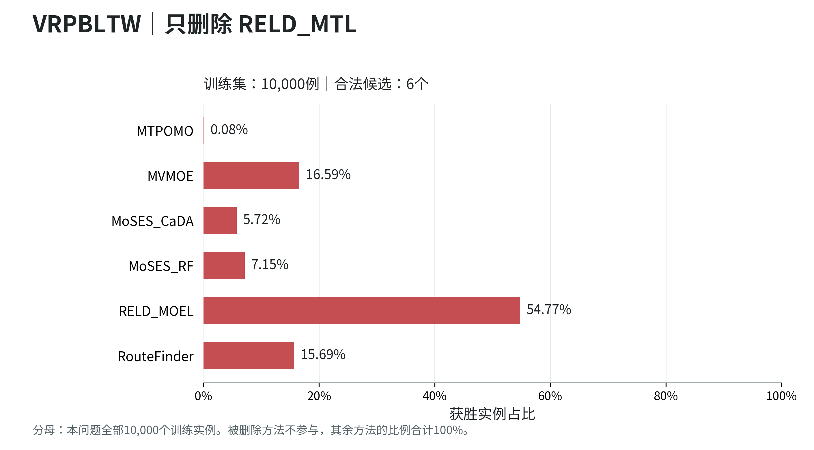

| 方法 | 获胜数量 | 占训练实例比例 |
| --- | ---: | ---: |
| MTPOMO | 8 | 0.08% |
| MVMOE | 1,659 | 16.59% |
| MoSES_CaDA | 572 | 5.72% |
| MoSES_RF | 715 | 7.15% |
| RELD_MOEL | 5,477 | 54.77% |
| RouteFinder | 1,569 | 15.69% |

[本情况CSV](tables_train/VRPBLTW_without_RELD_MTL.csv) · [本图PDF](figures_train/VRPBLTW_without_RELD_MTL.pdf)

### 只删除 RELD_MOEL

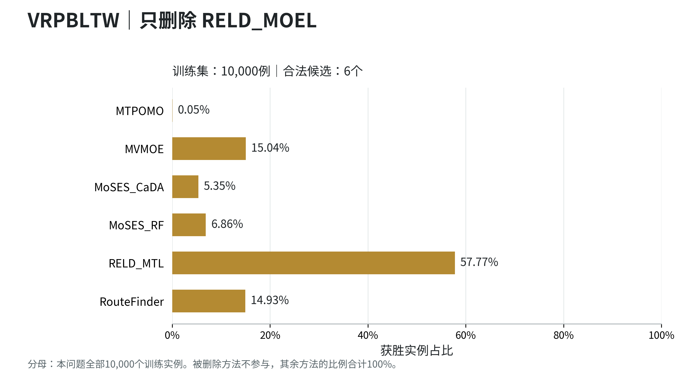

| 方法 | 获胜数量 | 占训练实例比例 |
| --- | ---: | ---: |
| MTPOMO | 5 | 0.05% |
| MVMOE | 1,504 | 15.04% |
| MoSES_CaDA | 535 | 5.35% |
| MoSES_RF | 686 | 6.86% |
| RELD_MTL | 5,777 | 57.77% |
| RouteFinder | 1,493 | 14.93% |

[本情况CSV](tables_train/VRPBLTW_without_RELD_MOEL.csv) · [本图PDF](figures_train/VRPBLTW_without_RELD_MOEL.pdf)

## OVRPBLTW

### 原候选池

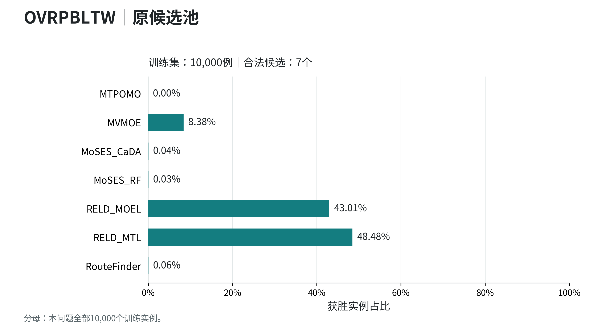

| 方法 | 获胜数量 | 占训练实例比例 |
| --- | ---: | ---: |
| MTPOMO | 0 | 0.00% |
| MVMOE | 838 | 8.38% |
| MoSES_CaDA | 4 | 0.04% |
| MoSES_RF | 3 | 0.03% |
| RELD_MOEL | 4,301 | 43.01% |
| RELD_MTL | 4,848 | 48.48% |
| RouteFinder | 6 | 0.06% |

[本情况CSV](tables_train/OVRPBLTW_original.csv) · [本图PDF](figures_train/OVRPBLTW_original.pdf)

### 只删除 RELD_MTL

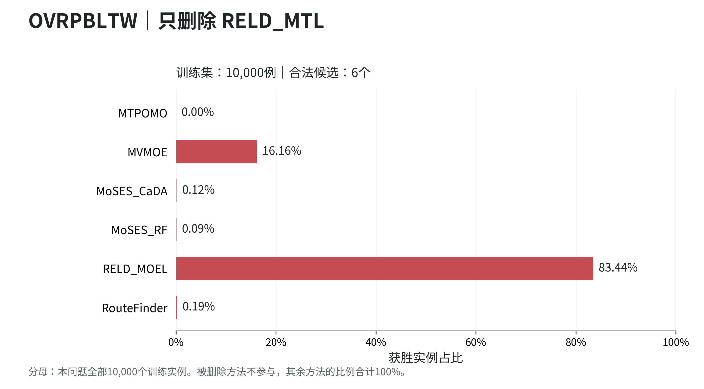

| 方法 | 获胜数量 | 占训练实例比例 |
| --- | ---: | ---: |
| MTPOMO | 0 | 0.00% |
| MVMOE | 1,616 | 16.16% |
| MoSES_CaDA | 12 | 0.12% |
| MoSES_RF | 9 | 0.09% |
| RELD_MOEL | 8,344 | 83.44% |
| RouteFinder | 19 | 0.19% |

[本情况CSV](tables_train/OVRPBLTW_without_RELD_MTL.csv) · [本图PDF](figures_train/OVRPBLTW_without_RELD_MTL.pdf)

### 只删除 RELD_MOEL

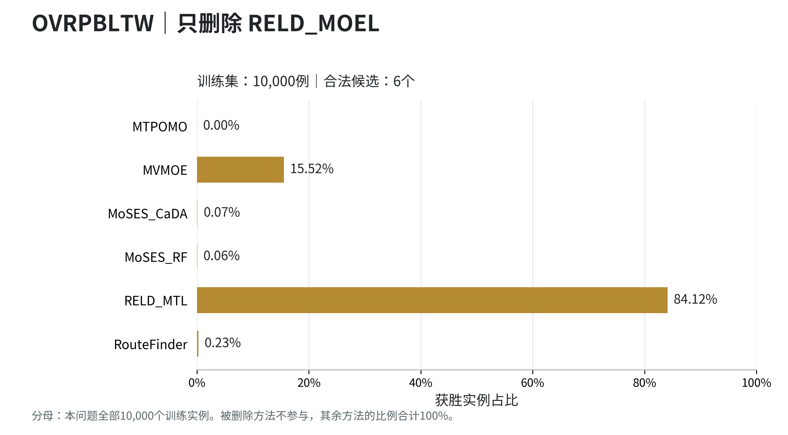

| 方法 | 获胜数量 | 占训练实例比例 |
| --- | ---: | ---: |
| MTPOMO | 0 | 0.00% |
| MVMOE | 1,552 | 15.52% |
| MoSES_CaDA | 7 | 0.07% |
| MoSES_RF | 6 | 0.06% |
| RELD_MTL | 8,412 | 84.12% |
| RouteFinder | 23 | 0.23% |

[本情况CSV](tables_train/OVRPBLTW_without_RELD_MOEL.csv) · [本图PDF](figures_train/OVRPBLTW_without_RELD_MOEL.pdf)

备注：带B任务仍使用原成本场景，本次不修复其已知语义问题；没有训练模型或复跑solver。
